# How Paladin Works (explained like you're 10)

> The diagrams use Mermaid. GitHub renders them, and in VS Code they show in the
> Markdown preview once a Mermaid extension (e.g. "Markdown Preview Mermaid Support") is installed.

## The big idea: Paladin is a restaurant 🍽️

Think of Paladin as a restaurant.

| Restaurant | Paladin | Where it lives |
|---|---|---|
| The dining room you sit in | The **desktop app** (Electron UI) | `desktop-app/src` |
| The waiter running between the two | **Electron main + preload** | `desktop-app/electron` |
| The kitchen | The **Go core** ("agent-host" sidecar) | `core/` |
| The head chef deciding who cooks next | The **turn hub** | `core/internal/runtime/hub.go` |
| A cook working on one order | The **agent loop** | `core/internal/agent/loop.go` |
| The cook's knives and pans | **Tools** (read, write, edit, shell…) | `core/internal/tools` |
| Guest chefs with their own gadgets | **MCP servers** | `core/internal/mcp` |
| The food supplier you phone | The **AI model** (via LiteLLM / providers) | `core/internal/inference` |
| A table with its own orders | A **session** | `core/internal/transcript` |
| The order notebook | **Transcript files** on disk | `<data>/sessions/…` |
| The recipe notebook everyone shares | **Memory** | `core/internal/memory` |
| "Ask the manager first!" | **Approvals / permissions** | `core/internal/permission` |
| A safety fence around the stove | **Sandbox** | `core/internal/sandbox` |
| A photo of the kitchen before cooking | **Snapshots** (for undo) | `core/internal/snapshot` |

The dining room never cooks. It only takes orders and shows the food as it arrives.
The kitchen does all the real work, and it keeps cooking even if you walk away from your table.

---

## 1. The three big pieces

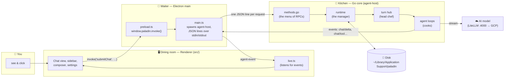

**In kid words:**
1. You type a message. The dining room hands it to the waiter.
2. The waiter writes it as **one line of JSON** and slides it under the kitchen door (the Go program's `stdin`).
3. The kitchen answers straight away: "Got it, order #turn-123." Then it keeps shouting updates
   ("I'm writing words!", "I'm using the shell!") as more JSON lines on `stdout`.
4. The waiter carries every shout back to the dining room, which paints it on screen **live**.

The renderer never talks to the Go program directly. It always goes through the waiter (`preload.ts` → `main.ts`).
That way a broken web page can't mess with the kitchen.

---

## 2. What happens when you press Enter

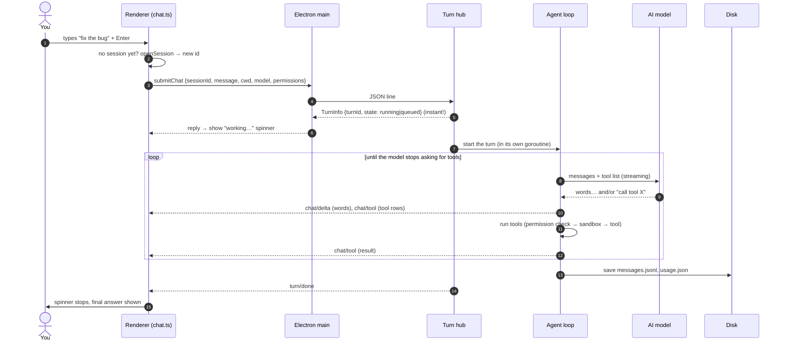

The important trick is **step 5**: `submitChat` answers **immediately**.
It doesn't wait for the cooking to finish. Everything after that arrives as **events**.
That's what makes Paladin "async": the UI is never stuck waiting.

---

## 3. Many sessions at once (the head chef)

A **session** is one conversation (one table). Each one has:
- an **id** (like `a1b2c3…`)
- a **folder** it works in (`cwd`)
- its own **history** on disk

The **turn hub** is the head chef. It has a few rules:

1. **Different tables can cook at the same time.** By default up to **4** run at once
   (`maxConcurrentTurns` in `config/settings.json`, max 16).
2. **One table cooks one dish at a time.** If you send a second message to a busy session, it waits
   in line behind the first. Lines are first-in-first-out.
3. **If all stoves are busy**, new orders wait until a stove frees up.
4. **Every shout gets a number (`seq`)** that always goes up, so nobody gets confused about order.

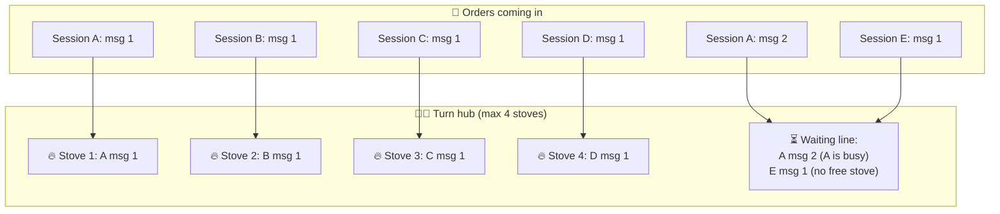

### Switching sessions without losing anything

Say you click from session A to session B while A is still cooking. **A keeps cooking.**
When you come back to A, the UI calls `attach`, and the kitchen hands over:
- the newest page of saved history (older rows load from `sessionHistoryPage` when you ask)
- everything the live turn has shouted **so far** (snapshotted with the current `seq`)
- anything still waiting in line

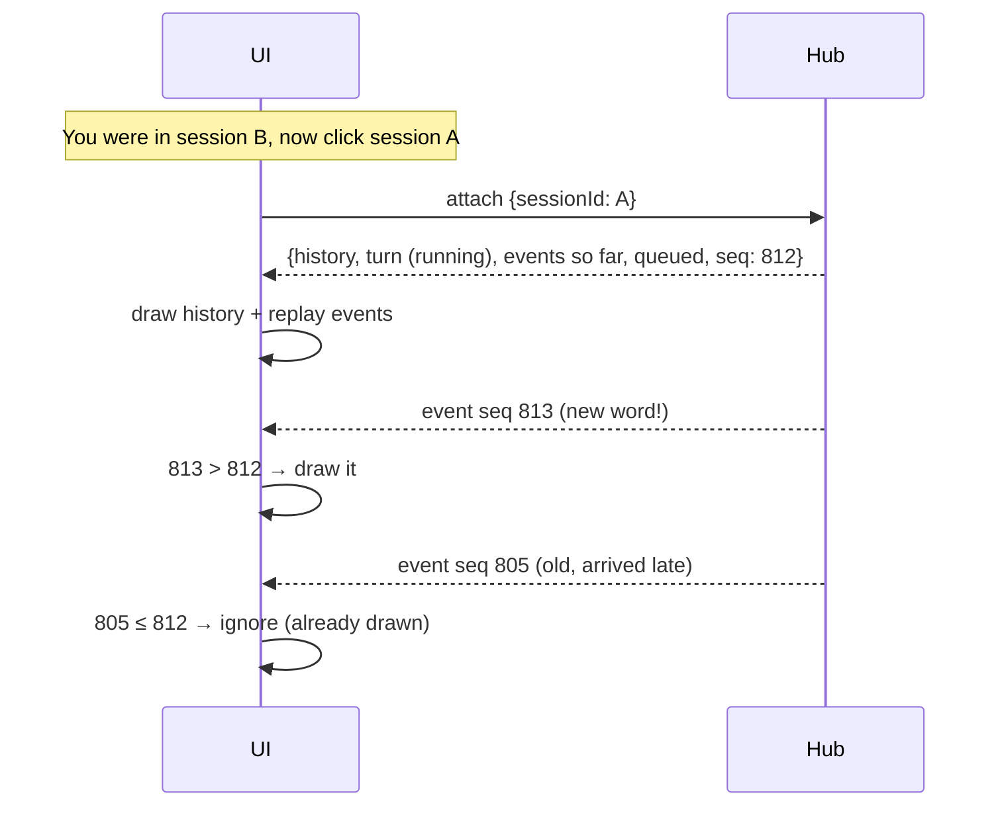

### The sidebar spinner

Every event names its `sessionId`. The sidebar watches `turn/start`, `turn/done` and `turn/queued`,
then puts a **spinner** (working), a **clock** (queued) or a **shield** (waiting for your approval) on each session row.
So you can see what's busy without opening it.

### Closing the app safely

When the app quits, the kitchen gets "stop". It stops every turn, **saves what it has**, and only then exits.
Half-finished turns are saved with a note so you can continue later.

### If the kitchen crashes

If the Go sidecar ever dies by surprise, the Electron app notices and starts a new one, waiting a little longer
after each crash in a row (half a second, then 1s, 2s… up to 30s). The window is told "the kitchen restarted",
so any turn that was cooking shows an "interrupted" error instead of spinning forever, and you can just send again.

---

## 4. Inside one turn (the cook's job)

This is the **agent loop** (`core/internal/agent/loop.go`). It's a "talk → use tools → talk again" circle.

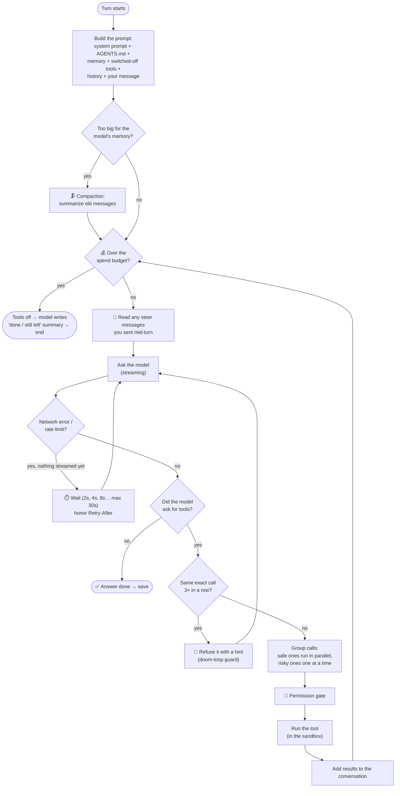

**The safety nets, in kid words:**

| Net | What it does |
|---|---|
| **Streaming watchdog** | If the model goes silent too long, hang up and retry instead of waiting forever. |
| **Retry with backoff** | Wait a bit longer each time (2s, 4s, 8s…) with some randomness, so all sessions don't retry at the same moment. |
| **Empty-reply rescue** | If the stream came back empty, ask once more without streaming. |
| **Doom-loop guard** | If the model keeps asking for the exact same thing (or loops A, B, A, B… through the same 2–4 calls three times), say "that won't change, try something else." The turn keeps going; the model has to adapt. Re-reads get a sharper variant: the content has not changed, use what you have. |
| **Denial breaker** | Three tool calls denied in a row (user declines, permission rule blocks) end the turn with a saved error instead of pestering forever. Any other result resets the count. |
| **Search-only refusal** | Eight consecutive rounds that only search or read (no writes, commands, or questions) get the next such round refused with guidance to summarize and act. Any round that acts resets the count. |
| **Output budgets** | Every search answer (grep, glob, list) is cut at 50 KiB with a pointer to narrow the query — the same role as read's 50 KiB pages and shell's 32 KiB inline cap (its whole output stays in the job log). No single tool result can flood the context. |
| **Plan reminder** | A turn that is about to end with steps still open gets reminded to finish or settle them. A round that runs tools restarts the count, so a long task that keeps working is never cut short; three stalls in a row with files changed and the plan still open end the turn as a resumable failure instead of a calm "next I will…". |
| **Stream keepalives** | Gateways send SSE frames with no data as pings. The SDK's decoder would choke on one and kill a healthy reply, so empty frames are dropped before it sees them, and a stream that still stops mid-frame is retried as a transport blip. Text already streamed is kept in the transcript. |
| **Edit-spiral note** | If the model edits the same file over and over without getting it clean (errors, or diagnostics that never clear), the result itself says so: batch all remaining fixes together, then run the build/tests and fix from their output instead of guessing. |
| **Tool-call budget** | A turn may run at most 200 tool calls. Past that the turn ends with a saved, resumable error instead of looping forever. |
| **Parallel batches** | Reading 5 files? Do it at once (up to 8). Writing or running shell? One at a time, in order. |
| **Orphan fixing** | Every "call tool" in history always gets a matching "result", even after a crash or stop, so the model never gets confused. |
| **Check before finishing** | If a turn is about to end after it changed code and no **check** has passed since, the model gets **one** short reminder naming the changed files: run a check if one applies, or say why not. Only builds, tests, linters and type checks count (`go test`, `npm test` / `pnpm run lint`, `pytest`, `tsc`, `cargo check`, `make` targets and the like); `pwd`, `ls` or a refused or background command do not. The reminder asks for the narrowest check that covers the changed files, because a repository-wide suite can spawn dozens of compiler and browser processes. A check that fails keeps the reminder, which then says the last check failed. The exit code decides, unless something other than `&&` follows the check (`| tail`, `; echo`), in which case the output is scanned for failures. Doc-only changes (`.md`, `.txt`, images) don't count, it never fires when tools are off (budget wrap-up), and it can be switched off in Settings → Tools → Behavior (`verifyNudge`). The reminder is saved in history as "Check before finishing". |
| **Argument fixing** | Models sometimes send `"20"` for a number, `"true"` for a yes/no, a list written as a string, or `null` for a field they meant to skip. Paladin fixes those against the tool's schema (built-in, MCP and extension tools) before the call runs, so the permission gate and the tool see the same fixed arguments. Anything unclear is left alone for the tool to reject. |
| **Panic catcher** | A tool crashing doesn't crash the kitchen. It becomes an error result. |
| **No round cap** | Like Codex and OpenCode, a turn runs until the model answers without asking for a tool, you press stop, or something breaks for good. The guards above keep it from spinning. |
| **Compaction** | When the conversation gets too long, older parts get summarized so it still fits (auto-compaction fires at 85% of the model's window; unknown windows assume 200k so a missing listing can't disable it). If compacting stops freeing space several times in a row, the turn ends with an error instead of looping. |
| **Spend budget** | Optional dollar limit per session (composer chip, `/budget 2.50`, or a default in Settings → Analytics). When spend crosses it, tools are switched off and the model writes a short "what's done / what's left" summary, then the turn ends. It's a **tracked-cost limit, not a guaranteed cap**: it only counts the cost your provider reports, and the call that crosses it (plus the summary) still runs. If the provider reports no cost, you get a warning that the limit isn't enforced; if the usage record got damaged, spend shown is only "at least" this much. |

**Steering.** While a turn runs, the composer shows a **Steer** button (or press ⌘/Ctrl+Enter). Your message is slipped into the *running* turn: the agent reads it before its next model call, so you can correct course without stopping. Plain Enter still queues a separate follow-up turn.

---

## 5. Tools (the knives and pans)

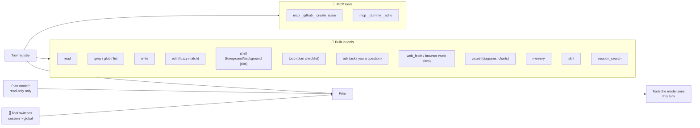

### The web: web_fetch and the browser

The agent can read the web two ways. **`web_fetch`** gets one http(s) page and hands the model readable Markdown (or
plain text / raw HTML): the main content when the page marks it, headings, lists, links, code, tables, no scripts or
page chrome. Long pages come in chunks (`start_index` / `next_index`). The **`browser`** tool and the side pane's
browser, which used to open only `localhost`, now open web sites too, for pages that need JavaScript or clicking.

- **Each new site asks first.** The first visit to a domain shows an approval card (once / this session / this folder /
  everywhere / deny). The answer becomes a `web` permission rule (`example.com` also covers its subdomains; `*` is
  every site), and Settings → Permissions lists them under "site", where you can add allow or deny rules by hand.
  Full access skips the card like it does for everything else; deny rules always win. Local apps never ask.
- **Private networks stay closed.** web_fetch checks the address a name resolves to (and connects to exactly that
  address), so neither a URL nor DNS can lead it to `10.x`, `192.168.x`, link-local cloud metadata or this machine
  under another name. Settings → Tools → Behavior → *Private and internal networks* opens intranet sites.
  `localhost` and `127.0.0.1` always work. Through a corporate proxy, names only the proxy can resolve are let through.
- **Redirects stay on the site.** A redirect to another site is reported (`redirect_to`), not followed, so the agent
  has to ask for it.
- **The pane is its own browser.** Each session's pane has a separate, empty, in-memory profile: no cookies from your
  ChatGPT or Claude tabs, no logins. Inside it a page may navigate only within sites opened in that session (by you
  in the URL bar or by the agent after you approved); other links are blocked and reported to the agent. A web page
  can load public resources (CDNs) but never `localhost` or private addresses; a local app still loads only local
  resources. Downloads and pop-ups are blocked.
- **Untrusted text.** Every fetched page says it is untrusted data, and the prompt tells the agent never to follow
  instructions found in it or send secrets to a site.
- Limits live in `settings.json` under `"web"`: `timeoutMs` (30 s), `maxBytes` (5 MB), `maxChars` (40 000 per chunk).

### Visuals

The **`visual`** tool lets the agent draw in the chat: an SVG diagram, a chart, a table or a small interactive HTML
widget, shown as a card in the turn (not folded into the tool group) and again when the session is reopened.

- It runs in an iframe sandboxed to scripts only, with its own opaque origin (no access to the app, its storage or the
  bridge) and a Content-Security-Policy that allows no network at all: no external scripts, fonts, images or fetch.
  Frames in the app window may not navigate anywhere either.
- The frame gets Paladin's theme as CSS variables (`--v-fg`, `--v-muted`, `--v-border`, `--v-accent`, `--v-good`,
  `--v-warn`, `--v-bad`, `--v-series-1…6`, `--v-font`, `--v-mono`) in dark and light, and follows a theme switch.
- The card sizes itself to the content. Its buttons show the source, open it larger (Escape closes) and save it as an
  `.svg` or `.html` file. A copy is also kept in `<session>/visuals/`.
- A script can call `paladin.sendPrompt(text)`: it fills your message box, it never sends.

### Search tools (grep, glob, list)

`grep` searches file contents, `glob` finds files by name (newest first) and `list` draws a folder tree with file counts.
They're read-only, so they run in parallel and are available in plan mode and to subagents.
They use **ripgrep** when it's installed and a built-in search otherwise; inside a git repo both honor `.gitignore`.
They never follow symlinks and skip `.git` and `node_modules`. Searching a folder **outside** the workspace asks first,
just like `read`, and "remember" grants that folder. A deny rule on anything inside it blocks the search.

### Formatting after write and edit

After `write` or `edit` changes a file **inside the workspace**, Paladin runs the formatter the project already uses,
if it's installed: `gofmt` for Go, `rustfmt` for Rust, `ruff` or `black` for Python only when `pyproject.toml` (or
`ruff.toml`) configures them, and `prettier` only from the project's own `node_modules/.bin`. Nothing is downloaded and
`npx` is never used. The formatter reads the file on stdin inside a read-only sandbox, and its output replaces the file
through the same conflict check as `edit`. The tool result says `formatted: "gofmt"` with a note to re-read, and the row
shows a "formatted · gofmt" chip. A failing or slow formatter (10 s) leaves the file as written. Switch it off in
Settings → Tools → Behavior (`formatOnWrite` in `settings.json`).

### Language server errors after write and edit

After `write` or `edit` changes a file **inside the workspace**, Paladin asks a language server for that file's errors
and adds them to the tool result (`diagnostics`, at most 20, plus a note asking the model to fix them or say why
they're expected). The row shows an "N errors · gopls" chip and lists them. Only servers that are **already installed**
are used, nothing is downloaded: `gopls`, `typescript-language-server`, `pyright` / `basedpyright`, `rust-analyzer` and
`clangd`, found in the project (`node_modules/.bin`, `.venv/bin`) or on PATH.

- One server runs per kind and project root (the nearest `go.mod`, `package.json`, `pyproject.toml`… inside the
  workspace). It starts when the agent first **reads** a file it handles, so it has loaded the project by the first edit.
- An edit waits at most 1.5 s for the answer (up to 10 s while a server is still starting); a slow server adds nothing.
- A server that fails to start is left off for a minute; idle servers stop after 10 minutes, and all of them stop with
  the app. Settings → Tools → Behavior shows each running server and has the on/off switch (`lspDiagnostics`).
- `<data>/config/lsp.json` can change things: `{"timeoutMs": 3000, "servers": {"gopls": {"disabled": true},
  "mylang": {"command": ["mylang-lsp", "--stdio"], "extensions": [".ml"]}}}`. There is no per-folder `lsp.json`
  (it would run commands from a cloned repo).
- Files over 1 MB are never sent to a server: they can still be read in pages, they just get no diagnostics.

### AGENTS.md in subfolders

The system prompt holds the AGENTS.md files from the project root down to the session folder. In a monorepo the rules
often live deeper (`services/api/AGENTS.md`). The first time `read`, `write` or `edit` touches a file in such a
subfolder, the AGENTS.md (or AGENTS.override.md / CLAUDE.md) files between the session folder and that file ride along
in the tool result as `nested_instructions`, so the prompt and its cache stay untouched. When that first touch is a
`write` or `edit`, the call is **held, not run**: its result carries the instructions and asks the agent to resend it
(changed if the rules require), so nothing in the folder changes before the agent has read them. A held call skips
hooks and the approval card; the resent one goes through both as usual. Each file arrives once per
session (remembered in `nested-instructions.json` next to the transcript), within a 32 KB budget. The read row shows a
"+ folder instructions" chip when this happens.

### Long output is kept, not lost

A shell command writes its whole output to its job log under `<session>/tmp/`; the model gets at most 32 KB of it
(the start and end around a truncation marker). A truncated result names the log (`output_file`), and the job's own
answer names it as `log`, so the model can `read` or `grep` the missing middle instead of running the command again.
MCP results over 40 000 characters are saved to `<session>/tool-output/<call id>.txt`. A session may always read its
own folder (these files, background job logs, screenshots) without an approval card; a deny rule still wins. The
files go away with the session.

### Tool switches (on/off)

Every tool can be switched on or off in two places:

- **Global** (Settings → Tools): the default for **everything**.
- **Session** (the composer's **Tools** menu or `/tools`): **Default / On / Off** for **this session only**.

**Rule: the session wins.** If global says "shell OFF" but this session says "shell ON", shell is on here.

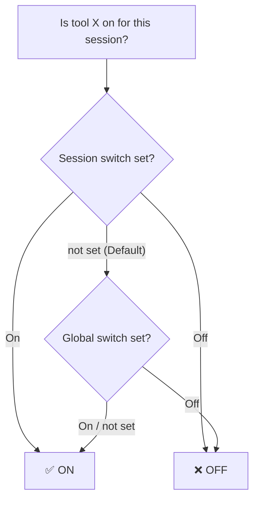

### "New tools arrived!" (protecting the prompt cache)

Models remember the beginning of a conversation (the **prompt cache**) to go faster and cheaper.
If the tool list suddenly changes in the middle, that memory is thrown away.
So when a new MCP server shows up in an **existing** session:

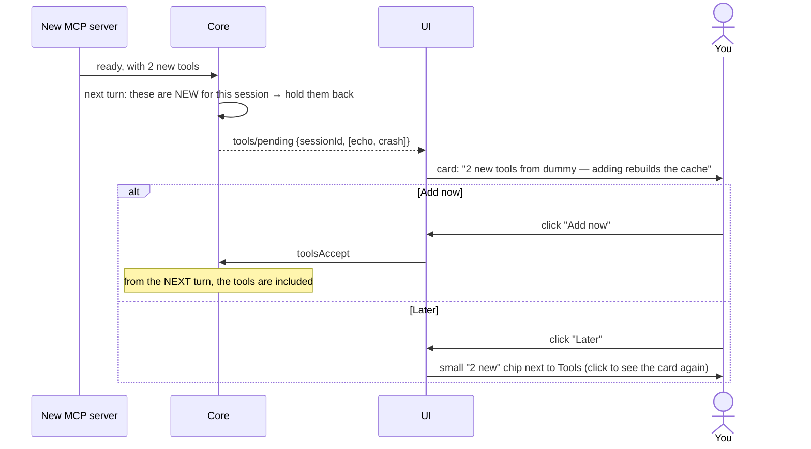

**Brand-new sessions** get every tool right away, because there's no cache to protect yet.

---

## 6. MCP servers (guest chefs)

MCP (Model Context Protocol) lets other programs lend Paladin more tools.

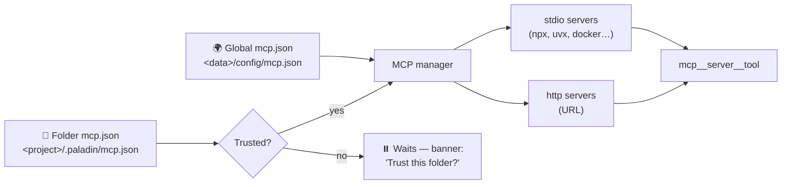

- **Two places for config:** global (everywhere) and per-folder. If a folder server has the same name as a global one, the folder version **replaces** it in that folder.
- **Trust:** a folder's `mcp.json` could have been written by anyone (e.g. it came with a cloned repo), so it does nothing until you click **Trust**.
- **Lazy start:** a server starts when it's first needed. Global ones start at boot.
- **Crash recovery:** if a server dies, it restarts on the next use. Its error log is kept (with a `--- restarted ---` line) so you can see why.
- **Paste to add:** Settings → MCP → **Add server**. Paste `npx -y @modelcontextprotocol/server-github`, a URL, a `claude mcp add …` line or an `mcp.json` snippet. Paladin works out a name, shows a preview you can edit, and saves it.

---

## 7. Permissions, approvals and the sandbox (safety)

Before any risky tool runs, it goes through the **permission gate**.

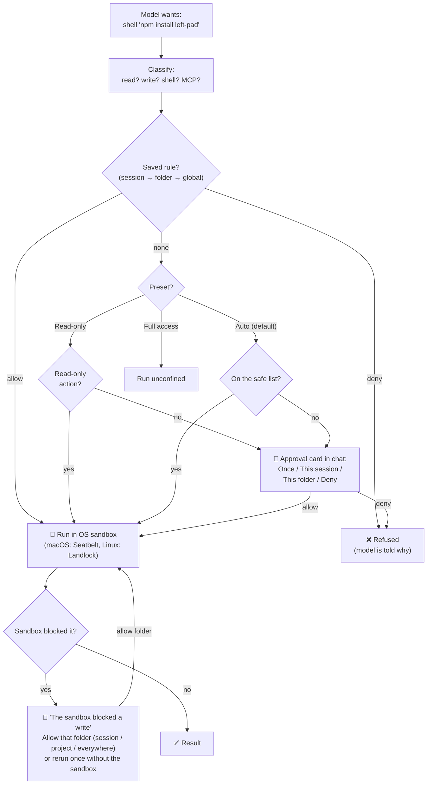

- **The three presets** (the shield chip in the composer): **Read-only**, **Auto**, **Full access**.
- **Approval cards** pause **only that session**. Other sessions keep cooking, and the sidebar shows a shield on the waiting one.
- **"Remember" answers** become rules saved for the session, the folder or globally.
- **The sandbox** is a fence: inside it, shell commands can only write inside your project folder (plus temp and package caches). They can still read everything.
- **Opening a gate in the fence:** if a command bumps into the fence, the card names the folder it wanted and offers to open just that one, for the session, the project or everywhere. The command then reruns, still fenced. An "allow writes to `/some/dir`" rule in Settings → Permissions does the same ahead of time (it also covers the write/edit tools). "Rerun without the sandbox" is the one-off "climb over the fence" option.
- **Peeking outside the kitchen:** the fence doesn't stop *reading*, so the gate does. Reading a file outside your project (with the `read` tool, or a "look-only" command like `cat ~/.ssh/...`) asks first and can remember "reads in this folder". It's best effort: Paladin only looks at the paths written in the command.
- **No secret-spilling shortcuts:** `env`, `printenv`, `go env` and `git config` are not "safe" and are refused in plan mode, and shell output, errors and logs blur things that look like keys or passwords (pattern-based, so it can miss odd ones).
- **MCP tools are strangers:** a server saying "this tool is read-only" is just a claim. Paladin still asks (unless you made a rule), runs MCP calls one at a time, and in plan mode asks for every MCP call.

### Hooks (your own kitchen rules 📋)

A **hook** is a little script of yours that Paladin runs at certain moments.
It's like taping a rule to the kitchen wall: "before anyone uses the big knife, check with me".

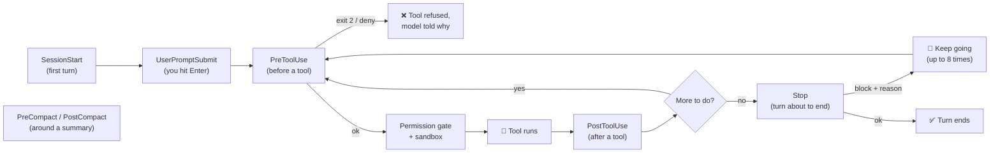

- **Same format as Codex and Claude Code.** Paladin reads its own `hooks.json` (global, and `.paladin/hooks.json` in a folder), plus a folder's `.codex/hooks.json` and `.claude/settings.json`.
- **How a hook talks back:** it gets a JSON note on stdin (the tool, its input, the prompt…). Exit `2` blocks the action (stderr is the reason). Printing JSON can add context for the model, allow or ask for a tool, or stop the turn.
- **Hooks never loosen safety.** A hook saying "allow" skips the approval card, but a deny rule or the sandbox still applies. "ask" forces a card.
- **Trust:** hooks run your commands **outside the sandbox**, so a folder's hook files stay off until you trust them in Settings → Hooks. Trust is pinned to the file's content, so if the file changes it needs trust again.
- **What you see:** a quiet one-line row in the turn ("PreToolUse hook blocked: …"). Settings → Hooks lists every file and handler, with on/off switches and an editor.

---

## 8. Undo and worktrees (time travel ⏪ and parallel universes 🌌)

### Undo with snapshots

Before a user turn starts, Paladin takes a **photo** of the folder. That is the only photo: nothing is captured per tool call, and commands never hold a folder lock.
It uses a hidden git repo under `<data>/snapshots/`, so your own `.git` is never touched.

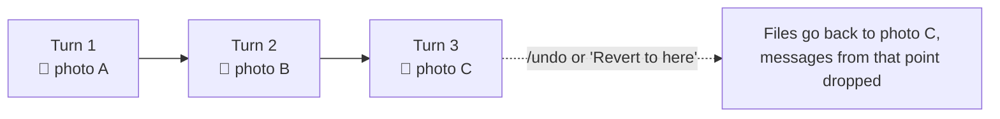

- **Exact restore:** files changed since the photo go back to their old content, and files created since are deleted. The revert is final — there is no redo.
- **Revert preview** lists what will be restored and what will be deleted, and says plainly that it cannot be undone.
- **One scan per turn:** a cold photo can take a moment on a huge folder; warm photos are a few milliseconds. The scan happens before the first model call, not around each command.

### Worktrees

A **worktree** is a second copy of your git repo on its own branch (`paladin/…`).
A session can work there without touching your main checkout.

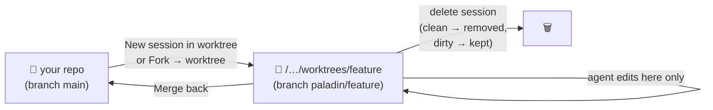

**Fork** copies a conversation into a new session. It can also give the copy its own worktree, to try a different idea.

### Subagents (helper cooks 👩‍🍳👨‍🍳)

A cook can hand a focused job to a **helper cook**: "go read every file about login and tell me how it works". The helper is a **subagent**: its own session, with its own conversation, running in the background like any other session.

There are two kinds, and both are **read-only** (they look, they never write):

| Kind | Job |
|---|---|
| `explore` | Search and read the codebase and report what it found |
| `reviewer` | Review code or a diff and report problems |

The main cook controls helpers with six tools: `spawn_agent` (hire one with a task), `wait_agent` (wait for answers, for a limited time), `send_message` (tip a helper mid-job), `followup_task` (give a finished helper more work), `interrupt_agent` (stop one) and `list_agents`.

- **Fresh or full memory.** `fork_turns: "none"` (the default) gives the helper only its task, so it stays small and cheap. `fork_turns: "all"` also gives it a copy of the conversation so far (finished turns only).
- **Never more power than the boss.** A helper's tools are its kind's list, narrowed by the parent's tool switches. It goes through the same approvals, hooks, sandbox and budget, and it can't hire helpers of its own (one level only, for now). At most 5 helpers work at once per parent (`maxSubagents`), even when the cook hires several in parallel, and re-hiring a finished helper with `followup_task` needs a free spot too.
- **Shared kitchen.** Helpers work in the parent's folder. They're read-only, so they can't step on each other's files. Background shell jobs are private to the session that started them, so a helper can't check on or cancel anyone else's job.
- **Money is shared.** A helper's spend counts toward its parent's budget limit.
- **No deadlock.** With `maxConcurrentTurns: 1`, a parent waiting in `wait_agent` lends its slot to its helpers, so they still get to cook.
- **Answers always arrive.** When a helper finishes, the parent hears about it: through `wait_agent`, as a note before its next model call, or, if the parent is idle, by starting a short parent turn to read the result. An answer is crossed off only once the parent's turn holding it is saved, so a crash or failed save means it's delivered again. Each answer carries an id that is saved with it, so after a restart Paladin checks the parent's conversation and skips answers it already has: exactly once, never zero, never twice. The full helper conversation stays in the helper's own session; the parent gets only the summary plus the helper's id.

**In the app:**
- Helpers sit **under their parent** in the sidebar ("2 subagents", fold/unfold), each with a coloured status dot (queued, running, done, failed, stopped).
- Clicking one opens its full conversation in the main view, with a **"← parent"** bar at the top to go back. The composer is locked: only the parent gives a helper work.
- A `spawn_agent` row in the chat has an **Open** button that shows the helper **live in the right-hand pane**, next to the parent, with a Stop button. You can switch sessions and come back; both keep running.
- Helpers don't pop up "finished" notifications; their parent does.

---

## 9. Memory (the shared recipe notebook 📒)

Inspired by hermes-agent. Paladin remembers things **across sessions**.

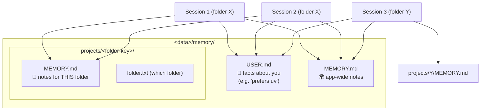

- The model uses the **`memory` tool** to add, replace or remove notes. Each notebook has a size limit, so it stays short.
- **Many sessions, same folder:** they share one folder notebook. Writes take a **file lock**, so two sessions can't scribble over each other.
- **Frozen snapshot per session:** at the start of a session, memory is copied into its prompt and stays fixed. A note written by session 2 doesn't suddenly change session 1's prompt (that would break its cache). Session 1 sees it next time it refreshes. `memorySnapshotStatus` reports when the stores on disk moved past that snapshot, and the refresh RPC re-reads them.
- **Tolerant addressing.** Models re-type text, so `old_text` matches byte-exact first and then after folding typography (curly quotes, em dashes, re-wrapped lines). A whole-entry match beats a substring; an ambiguous match lists the candidates instead of guessing.
- **Writes are checked, not trusted.** No-op patches, missing `old_text`, oversized entries and the `§` delimiter are refused; a threat scan blocks prompt-injection and exfiltration patterns on the way in *and* again when the store is rendered (a hand-edited poisoned file shows `[BLOCKED]`, never the text); secret-shaped values are masked on write and the tool reports which entries were masked.
- **`memory.json`** (`<data>/config/`) sets per-scope budgets, which scopes are off, the backend provider, the review nudge interval and `autoReview`. Absent means today's behaviour.
- **Review loop:** after N turns without a memory write, one short nudge paragraph asks the model to save what it learned. With `autoReview` on, a finished turn forks a child session that may only write memory (never the workspace) and replays the conversation to decide what is worth keeping.
- **Recall:** when your message clearly matches a stored entry (two or more content words, folded the same way), that one entry is repeated as a short reminder naming its scope — attention, not a second copy of the store.
- **`session_search`** answers "like last time" from a SQLite FTS index over past transcripts.
- You can view and edit everything in **Settings → Memory**, or with `/memories`.

The backend is behind a small seam (`core/internal/memory/provider.go`): read entries, fingerprint them, and mutate under a lock. The write rules — guards, scan, masking, budget, matching — live once above it, so a second backend cannot drift from them. Only the file backend exists today, deliberately.

---

## 10. Slash commands, skills and prompts

Type `/` in the composer and a menu pops up:

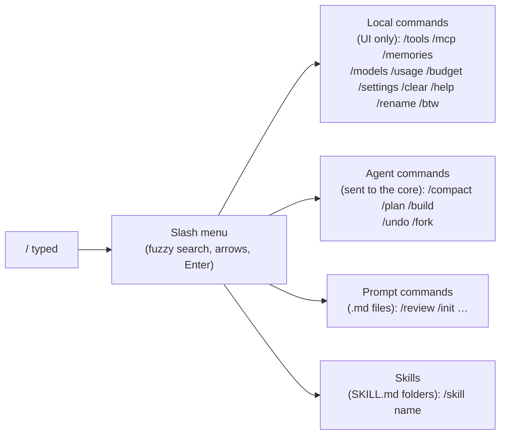

- **`/review [session | branch | commit | focus]`**: a read-only (plan mode) code review. With no argument it reviews uncommitted changes; `session` reviews only what this session changed (Paladin adds the diff from its snapshots; when the session has no snapshots or changed nothing, the command stops with that message before the model runs, instead of reviewing other changes); a branch or commit reviews `git diff <it>...HEAD`. The review ends with the **`report_findings`** tool, which only exists in `/review`'s turn (a command's `tools:` frontmatter switches such command-only tools on). The chat shows a **findings card**: the verdict, then each finding by priority (P0–P3) with its file and lines. Opening one shows the code around it with those lines marked, **View in changes** jumps to the session's diff with the same lines marked (when this session changed the file), and **Fix** puts the finding into the composer so you send it as a normal turn. Adding the tool changes the tool list for that one turn, so the review turn (and the next) re-reads the prompt cache once.
- **Customize (Settings → Customize)**: every built-in text the agent gets is editable there: the system prompt, the tool guidance ("when to use which tool"), the shell rules, the tool examples, each tool's description, plan mode and the `/btw` wrapper, the reminders (check before finishing, budget, folder instructions, formatter and language server notes, untrusted web content, switched-off tools), the subagent preamble and roles, the compaction prompts, the built-in commands (`/review`, `/init`), the built-in skills (with an on/off switch), and `settings.json` / `lsp.json` (validated before saving). Each item says what it does, which `{{placeholders}}` it fills in and where its file is; **Reset to default** deletes the override. Text edits are plain files in `<data>/config/custom/<id>.md`, so they can be edited by hand too. Overrides are global only: a cloned repository cannot rewrite the agent's instructions. The tools themselves stay fixed; their descriptions and guidance are what you edit. An edit applies from the next turn (a changed prompt section re-reads the prompt cache once).
- **Plan mode** (`/plan`): the agent only gets read-only tools. It looks around and proposes a plan.
- **Build mode** (`/build`): back to normal.
- **Skills**: packs of instructions the model can pull in when needed (with the `skill` tool), or that you attach to a turn. Paladin ships eight: `debugging`, `test-driven-development`, `safe-refactoring`, `code-review`, `security-review`, `web-research`, `diagrams-and-charts` and `writing-docs`. A skill of the same name in `config/skills/` (global) or `.paladin/skills/` (this folder) replaces a built-in, and `settings.json` `disabledSkills` turns any skill off; Settings → Customize does both.
- **`/btw [question]`**: whisper a side question to the cook without interrupting. It works **while a turn is running**: Paladin copies the conversation so far (including tools still running), asks the model once with no tools, and shows the answer in a **side chat** tab in the right-hand pane (the speech-bubble button in the title bar opens it). A bare `/btw` just opens an empty side chat, ready to type in. You can keep asking in that tab, open more tabs, and reopen old side chats from the pane's history menu. Side chats are saved next to the session (see §12) but **never added to the main conversation**; their cost counts toward usage and the budget.
- **Terminal tabs**: the side pane's terminal icon starts a real PTY in the session workspace, with your normal OS permissions. Each tab owns its shell and keeps it running while hidden. This is separate from the agent's sandboxed `shell` tool.
- **`! command` and `!! command`**: both run a user command outside the agent sandbox and show its output in the terminal pane. One `!` starts an agent turn after the command finishes, giving the agent the command, exit code and output. Two `!` characters never start a turn or enter agent history.

---

## 11. Providers and models (the food supplier ☁️)

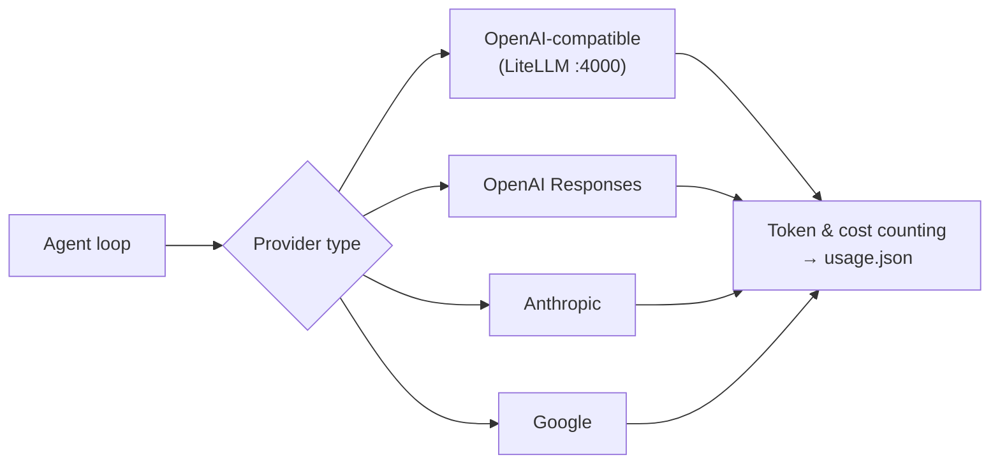

- Providers live in `<data>/config/providers.json`. Keys are kept in the OS keychain, not in plain text.
- **OpenRouter and OpenCode are never pinged automatically.** Their model lists only refresh when you press refresh.
- Each session tracks **tokens, cost and context size**. That's the `12.5% · $0.0042` pill at the top.
- **Thinking level (how hard the cook thinks 🧠):** a strip above the composer text shows the picked model and one clickable pill per level it accepts (Off, Minimal, Low, Medium, High, Extra High, Max). Picking one applies from the next message, so it can be changed mid-session. **More** next to the pills opens a slider over the same stops plus *Default* (the provider decides, nothing is sent), and `/thinking` opens that slider while `/thinking <level>` (or `/thinking default`) sets one from the keyboard. The choice is saved **per model for the whole app** in `settings.json` and is sent as `reasoning_effort`. The levels come from the provider's own model catalog when it publishes them (OpenCode Go does), else Paladin guesses from the model's name; a model with none says so in the strip instead of hiding the control. If a provider rejects the level, Paladin retries once without it and shows a notice. While the model thinks, a **Thinking** block streams in the chat and folds into **Thought** when the answer starts. The thinking is saved in history but never sent back to the model.

---

## 12. Where everything is saved 💾

`<data>` is `~/Library/Application Support/paladin` on macOS (or `$PALADIN_DATA_DIR`).

```text
<data>/
├── config/
│   ├── providers.json      ← AI providers (keys in keychain)
│   ├── models.json
│   ├── settings.json       ← e.g. maxConcurrentTurns
│   ├── SYSTEM_PROMPT.md    ← the editable system prompt
│   ├── custom/<id>.md      ← your edits of built-in texts (Settings → Customize)
│   ├── commands/, skills/  ← your commands and skills (and edited built-ins)
│   ├── lsp.json            ← language server overrides
│   ├── mcp.json            ← global MCP servers
│   ├── memory.json         ← memory budgets, disabled scopes, review, provider
│   └── tools.json          ← global tool switches
├── permissions/
│   ├── global.json         ← saved allow/deny rules (everywhere)
│   └── folders/<key>.json  ← rules for one folder
├── sessions/
│   └── <encoded folder>/
│       └── <session id>/
│           ├── messages.jsonl   ← the conversation, one turn per line
│           ├── meta.json        ← title, model, worktree, revert, tool switches,
│           │                       subagent link (parent/children)…
│           ├── usage.json       ← tokens & cost
│           ├── summary.json     ← list cache (count, title, bytes read); rebuildable
│           ├── error.log        ← every error of this session, raw (see below)
│           ├── tool-output/     ← full output of oversized tool results
│           └── side-chats/
│               └── <chat id>/chat.json  ← one /btw side chat
│       (a subagent is a session folder of its own, beside its parent,
│        with its own error.log)
├── memory/
│   ├── USER.md
│   ├── MEMORY.md
│   └── projects/<key>/MEMORY.md
└── snapshots/               ← hidden git repos for undo
```

Files are written **atomically**: a temp file first, then renamed into place.
So a crash in the middle never leaves a half-written file.

### error.log — the debugging trail

Every session folder keeps `error.log`, and so does every subagent session
(a child is a session with its own folder). Each line is
`time<TAB>source<TAB>raw error`, UTC, **unfiltered**: no redaction, no
truncation, no dedup, multi-line stack traces kept whole. Sources:

| Source | What lands there |
|---|---|
| `turn` | A turn that ended in failure (the exact error the UI showed). |
| `retry` | Every provider retry and why it happened. |
| `tool:<name>` | Every failed tool call: call id, arguments, raw result. |
| `compact:auto` | A compaction attempt that failed (the turn continues). |
| `panic` | A recovered panic with its full stack. |
| `subagent:<child id>` | In the parent's log: the child failed, with the path of the child's own log. |
| `rpc:<method>` | A request that failed outside a turn (open/rename/config…). |
| `rpc:unknown` | The client asked for a method this build does not have. |

Host errors with no session (bad request lines, startup, panics in a
request) go to `<data>/logs/errors.log`. `error.log` rotates to
`error.log.1` at 16 MiB so a runaway loop cannot fill the disk; nothing
else is ever dropped. A clean turn writes nothing, so an absent file
means "no errors" rather than "logging was off".

---

## 13. The renderer's parts (the dining room 🖥️)

Every file in `desktop-app/src/features/` owns one thing:

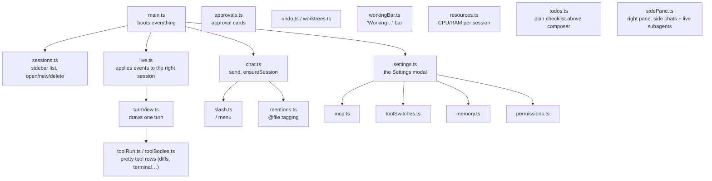

**`live.ts` is the mail sorter.** Every event has a `sessionId`. If it's for the session on screen, it's drawn right away.
If not, it's remembered, and only the sidebar row changes (spinner, unread dot).

**The sidebar is a drawer.** The app starts with it closed. In the Agent view it floats over the chat, like a sheet of paper laid on top, so the chat never squeezes or shifts. A click outside, Escape, or picking a session puts it away; clicking the Agent button on the left brings it back (there's no separate sidebar button). The Chat view (ChatGPT, Claude…) has no sidebar at all: those pages are real mini-browsers stuck on top of the window, and nothing can be drawn over them, so you switch between them with tabs along the top, like a browser.

---

## 14. The whole thing in one picture

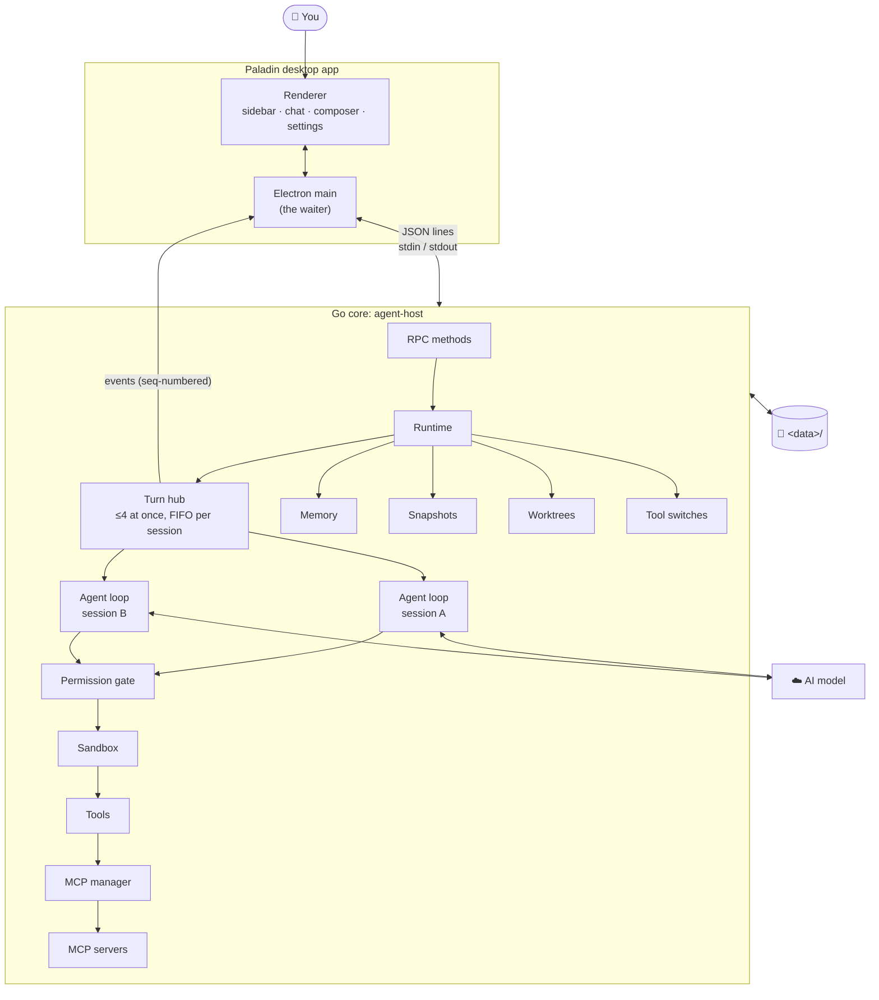

### The 5 rules that make it robust

1. **Answer fast, work in the background.** Requests return right away, and progress arrives as events.
2. **Every session is its own lane.** One stuck or failing session never blocks the others.
3. **Never lose work.** Save on every turn, write atomically, save on quit, pair every tool call with a result.
4. **Expect failure.** Retries with backoff, watchdogs, panic catchers, MCP restarts, doom-loop guard.
5. **Ask before danger.** Permission presets, approval cards, sandbox, folder trust, and asking before the tool list changes.
