# How Paladin Works (explained like you're 10)

> The diagrams use Mermaid. GitHub renders them, and in VS Code they show in the
> Markdown preview once a Mermaid extension (e.g. "Markdown Preview Mermaid Support") is installed.

## The big idea: Paladin is a restaurant 🍽️

Think of Paladin as a restaurant.

| Restaurant | Paladin | Where it lives |
|---|---|---|
| The dining room you sit in | The **desktop app** (Electron UI) | `desktop-app/src` |
| The waiter running between the two | **Electron main + preload** | `desktop-app/electron` |
| The kitchen | The **Go core** ("agent-host" sidecar) | `core/` |
| The head chef deciding who cooks next | The **turn hub** | `core/internal/runtime/hub.go` |
| A cook working on one order | The **agent loop** | `core/internal/agent/loop.go` |
| The cook's knives and pans | **Tools** (read, write, edit, shell…) | `core/internal/tools` |
| Guest chefs with their own gadgets | **MCP servers** | `core/internal/mcp` |
| The food supplier you phone | The **AI model** (via LiteLLM / providers) | `core/internal/inference` |
| A table with its own orders | A **session** | `core/internal/transcript` |
| The order notebook | **Transcript files** on disk | `<data>/sessions/…` |
| The recipe notebook everyone shares | **Memory** | `core/internal/memory` |
| "Ask the manager first!" | **Approvals / permissions** | `core/internal/permission` |
| A safety fence around the stove | **Sandbox** | `core/internal/sandbox` |
| A photo of the kitchen before cooking | **Snapshots** (for undo) | `core/internal/snapshot` |

The dining room never cooks. It only takes orders and shows the food as it arrives.
The kitchen does all the real work, and it keeps cooking even if you walk away from your table.

---

## 1. The three big pieces

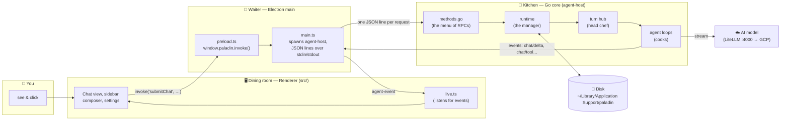

**In kid words:**
1. You type a message. The dining room hands it to the waiter.
2. The waiter writes it as **one line of JSON** and slides it under the kitchen door (the Go program's `stdin`).
3. The kitchen answers straight away: "Got it, order #turn-123." Then it keeps shouting updates
   ("I'm writing words!", "I'm using the shell!") as more JSON lines on `stdout`.
4. The waiter carries every shout back to the dining room, which paints it on screen **live**.

The renderer never talks to the Go program directly. It always goes through the waiter (`preload.ts` → `main.ts`).
That way a broken web page can't mess with the kitchen.

---

## 2. What happens when you press Enter

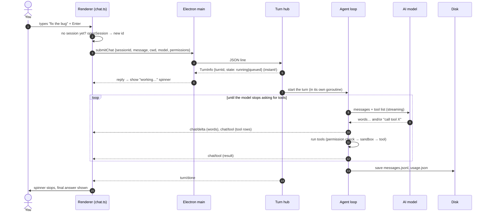

The important trick is **step 5**: `submitChat` answers **immediately**.
It doesn't wait for the cooking to finish. Everything after that arrives as **events**.
That's what makes Paladin "async": the UI is never stuck waiting.

---

## 3. Many sessions at once (the head chef)

A **session** is one conversation (one table). Each one has:
- an **id** (like `a1b2c3…`)
- a **folder** it works in (`cwd`)
- its own **history** on disk

The **turn hub** is the head chef. It has a few rules:

1. **Different tables can cook at the same time.** By default up to **4** run at once
   (`maxConcurrentTurns` in `config/settings.json`, max 16).
2. **One table cooks one dish at a time.** If you send a second message to a busy session, it waits
   in line behind the first. Lines are first-in-first-out.
3. **If all stoves are busy**, new orders wait until a stove frees up.
4. **Every shout gets a number (`seq`)** that always goes up, so nobody gets confused about order.

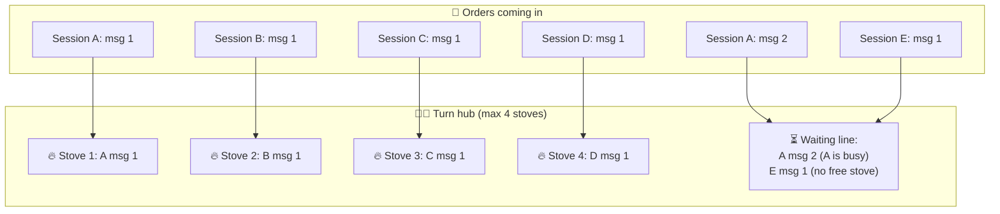

### Switching sessions without losing anything

Say you click from session A to session B while A is still cooking. **A keeps cooking.**
When you come back to A, the UI calls `attach`, and the kitchen hands over:
- everything already saved (history)
- everything the live turn has shouted **so far** (snapshotted with the current `seq`)
- anything still waiting in line

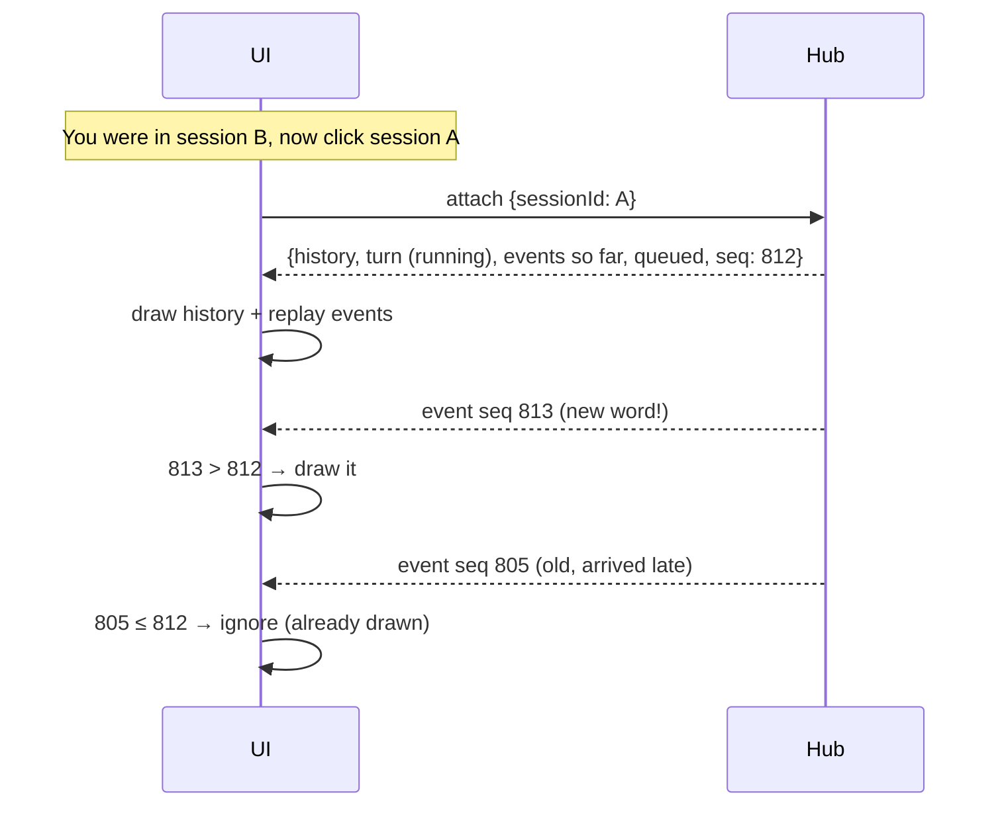

### The sidebar spinner

Every event names its `sessionId`. The sidebar watches `turn/start`, `turn/done` and `turn/queued`,
then puts a **spinner** (working), a **clock** (queued) or a **shield** (waiting for your approval) on each session row.
So you can see what's busy without opening it.

### Closing the app safely

When the app quits, the kitchen gets "stop". It stops every turn, **saves what it has**, and only then exits.
Half-finished turns are saved with a note so you can continue later.

### If the kitchen crashes

If the Go sidecar ever dies by surprise, the Electron app notices and starts a new one, waiting a little longer
after each crash in a row (half a second, then 1s, 2s… up to 30s). The window is told "the kitchen restarted",
so any turn that was cooking shows an "interrupted" error instead of spinning forever, and you can just send again.

---

## 4. Inside one turn (the cook's job)

This is the **agent loop** (`core/internal/agent/loop.go`). It's a "talk → use tools → talk again" circle.

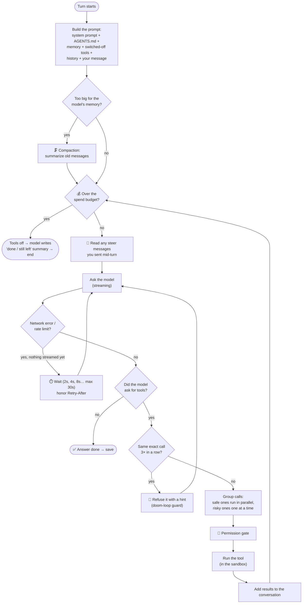

**The safety nets, in kid words:**

| Net | What it does |
|---|---|
| **Streaming watchdog** | If the model goes silent too long, hang up and retry instead of waiting forever. |
| **Retry with backoff** | Wait a bit longer each time (2s, 4s, 8s…) with some randomness, so all sessions don't retry at the same moment. |
| **Empty-reply rescue** | If the stream came back empty, ask once more without streaming. |
| **Doom-loop guard** | If the model keeps asking for the exact same thing (or loops A, B, A, B… through the same 2–4 calls three times), say "that won't change, try something else." The turn keeps going; the model has to adapt. |
| **Parallel batches** | Reading 5 files? Do it at once (up to 8). Writing or running shell? One at a time, in order. |
| **Orphan fixing** | Every "call tool" in history always gets a matching "result", even after a crash or stop, so the model never gets confused. |
| **Panic catcher** | A tool crashing doesn't crash the kitchen. It becomes an error result. |
| **No round cap** | Like Codex and OpenCode, a turn runs until the model answers without asking for a tool, you press stop, or something breaks for good. The guards above keep it from spinning. |
| **Compaction** | When the conversation gets too long, older parts get summarized so it still fits. If compacting stops freeing space several times in a row, the turn ends with an error instead of looping. |
| **Spend budget** | Optional dollar limit per session (composer chip, `/budget 2.50`, or a default in Settings → Analytics). When spend crosses it, tools are switched off and the model writes a short "what's done / what's left" summary, then the turn ends. It's a **tracked-cost limit, not a guaranteed cap**: it only counts the cost your provider reports, and the call that crosses it (plus the summary) still runs. If the provider reports no cost, you get a warning that the limit isn't enforced; if the usage record got damaged, spend shown is only "at least" this much. |

**Steering.** While a turn runs, the composer shows a **Steer** button (or press ⌘/Ctrl+Enter). Your message is slipped into the *running* turn: the agent reads it before its next model call, so you can correct course without stopping. Plain Enter still queues a separate follow-up turn.

---

## 5. Tools (the knives and pans)

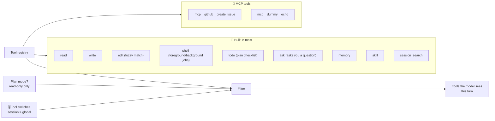

### Tool switches (on/off)

Every tool can be switched on or off in two places:

- **Global** (Settings → Tools): the default for **everything**.
- **Session** (the composer's **Tools** menu or `/tools`): **Default / On / Off** for **this session only**.

**Rule: the session wins.** If global says "shell OFF" but this session says "shell ON", shell is on here.

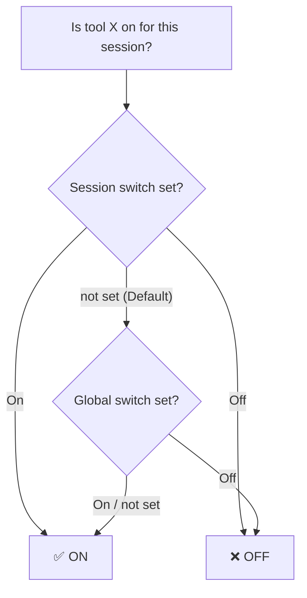

### "New tools arrived!" (protecting the prompt cache)

Models remember the beginning of a conversation (the **prompt cache**) to go faster and cheaper.
If the tool list suddenly changes in the middle, that memory is thrown away.
So when a new MCP server shows up in an **existing** session:

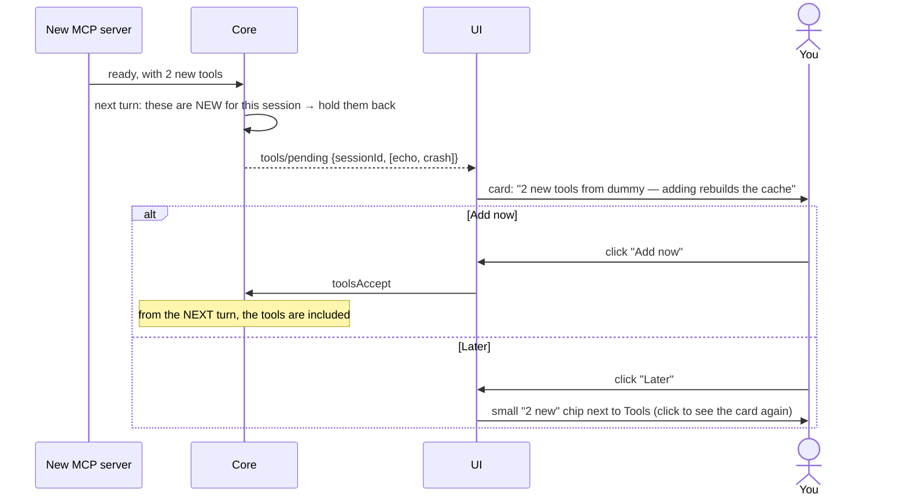

**Brand-new sessions** get every tool right away, because there's no cache to protect yet.

---

## 6. MCP servers (guest chefs)

MCP (Model Context Protocol) lets other programs lend Paladin more tools.

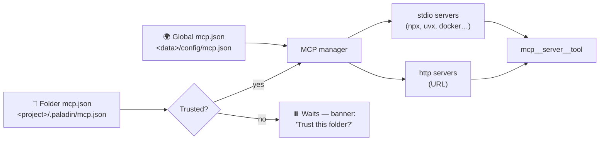

- **Two places for config:** global (everywhere) and per-folder. If a folder server has the same name as a global one, the folder version **replaces** it in that folder.
- **Trust:** a folder's `mcp.json` could have been written by anyone (e.g. it came with a cloned repo), so it does nothing until you click **Trust**.
- **Lazy start:** a server starts when it's first needed. Global ones start at boot.
- **Crash recovery:** if a server dies, it restarts on the next use. Its error log is kept (with a `--- restarted ---` line) so you can see why.
- **Paste to add:** Settings → MCP → **Add server**. Paste `npx -y @modelcontextprotocol/server-github`, a URL, a `claude mcp add …` line or an `mcp.json` snippet. Paladin works out a name, shows a preview you can edit, and saves it.

---

## 7. Permissions, approvals and the sandbox (safety)

Before any risky tool runs, it goes through the **permission gate**.

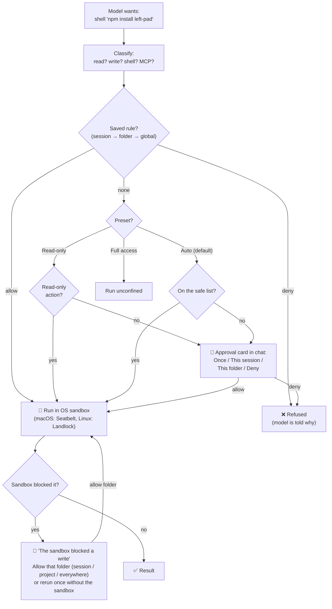

- **The three presets** (the shield chip in the composer): **Read-only**, **Auto**, **Full access**.
- **Approval cards** pause **only that session**. Other sessions keep cooking, and the sidebar shows a shield on the waiting one.
- **"Remember" answers** become rules saved for the session, the folder or globally.
- **The sandbox** is a fence: inside it, shell commands can only write inside your project folder (plus temp and package caches). They can still read everything.
- **Opening a gate in the fence:** if a command bumps into the fence, the card names the folder it wanted and offers to open just that one, for the session, the project or everywhere. The command then reruns, still fenced. An "allow writes to `/some/dir`" rule in Settings → Permissions does the same ahead of time (it also covers the write/edit tools). "Rerun without the sandbox" is the one-off "climb over the fence" option.
- **Peeking outside the kitchen:** the fence doesn't stop *reading*, so the gate does. Reading a file outside your project (with the `read` tool, or a "look-only" command like `cat ~/.ssh/...`) asks first and can remember "reads in this folder". It's best effort: Paladin only looks at the paths written in the command.
- **No secret-spilling shortcuts:** `env`, `printenv`, `go env` and `git config` are not "safe" and are refused in plan mode, and shell output, errors and logs blur things that look like keys or passwords (pattern-based, so it can miss odd ones).
- **MCP tools are strangers:** a server saying "this tool is read-only" is just a claim. Paladin still asks (unless you made a rule), runs MCP calls one at a time, and in plan mode asks for every MCP call.

### Hooks (your own kitchen rules 📋)

A **hook** is a little script of yours that Paladin runs at certain moments.
It's like taping a rule to the kitchen wall: "before anyone uses the big knife, check with me".

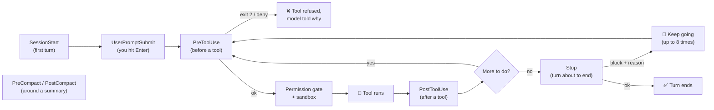

- **Same format as Codex and Claude Code.** Paladin reads its own `hooks.json` (global, and `.paladin/hooks.json` in a folder), plus a folder's `.codex/hooks.json` and `.claude/settings.json`.
- **How a hook talks back:** it gets a JSON note on stdin (the tool, its input, the prompt…). Exit `2` blocks the action (stderr is the reason). Printing JSON can add context for the model, allow or ask for a tool, or stop the turn.
- **Hooks never loosen safety.** A hook saying "allow" skips the approval card, but a deny rule or the sandbox still applies. "ask" forces a card.
- **Trust:** hooks run your commands **outside the sandbox**, so a folder's hook files stay off until you trust them in Settings → Hooks. Trust is pinned to the file's content, so if the file changes it needs trust again.
- **What you see:** a quiet one-line row in the turn ("PreToolUse hook blocked: …"). Settings → Hooks lists every file and handler, with on/off switches and an editor.

---

## 8. Undo and worktrees (time travel ⏪ and parallel universes 🌌)

### Undo with snapshots

Before a turn changes files, Paladin takes a **photo** of the folder.
It uses a hidden git repo under `<data>/snapshots/`, so your own `.git` is never touched.

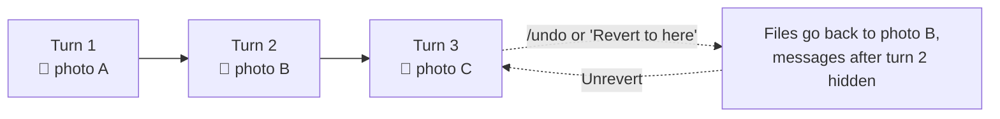

- **Revert preview** shows which files would change, and warns about **conflicts** (files you edited by hand since).
- **Unrevert** brings it all back, as long as you haven't sent a new message yet.

### Worktrees

A **worktree** is a second copy of your git repo on its own branch (`paladin/…`).
A session can work there without touching your main checkout.

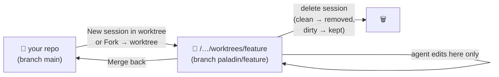

**Fork** copies a conversation into a new session. It can also give the copy its own worktree, to try a different idea.

---

## 9. Memory (the shared recipe notebook 📒)

Inspired by hermes-agent. Paladin remembers things **across sessions**.

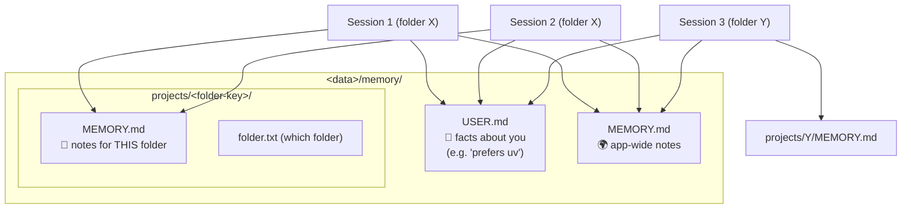

- The model uses the **`memory` tool** to add, replace or remove notes. Each notebook has a size limit, so it stays short.
- **Many sessions, same folder:** they share one folder notebook. Writes take a **file lock**, so two sessions can't scribble over each other.
- **Frozen snapshot per session:** at the start of a session, memory is copied into its prompt and stays fixed. A note written by session 2 doesn't suddenly change session 1's prompt (that would break its cache). Session 1 sees it next time it refreshes.
- You can view and edit everything in **Settings → Memory**, or with `/memories`.

---

## 10. Slash commands, skills and prompts

Type `/` in the composer and a menu pops up:

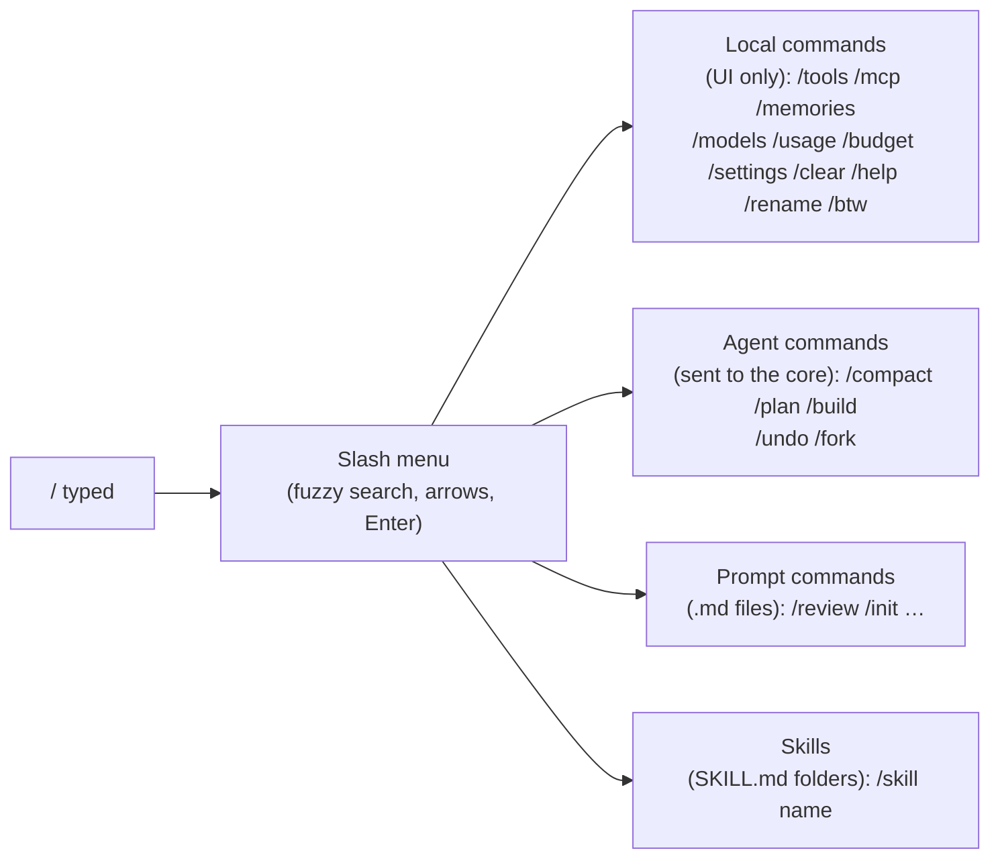

- **Plan mode** (`/plan`): the agent only gets read-only tools. It looks around and proposes a plan.
- **Build mode** (`/build`): back to normal.
- **Skills**: packs of instructions the model can pull in when needed (with the `skill` tool), or that you attach to a turn.
- **`/btw <question>`**: whisper a side question to the cook without interrupting. It works **while a turn is running**: Paladin copies the conversation so far (including tools still running), asks the model once with no tools, and shows the answer in a card you can dismiss. It is **never saved** to the chat, but its cost counts toward usage and the budget.

---

## 11. Providers and models (the food supplier ☁️)

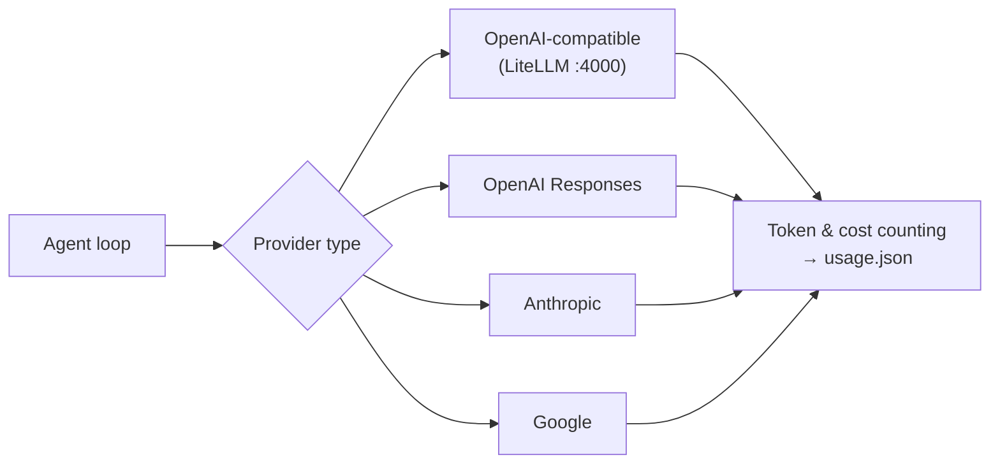

- Providers live in `<data>/config/providers.json`. Keys are kept in the OS keychain, not in plain text.
- **OpenRouter and OpenCode are never pinged automatically.** Their model lists only refresh when you press refresh.
- Each session tracks **tokens, cost and context size**. That's the `12.5% · $0.0042` pill at the top.
- **Thinking level (how hard the cook thinks 🧠):** the ⚡ chip next to the model button opens a slider: *Default* (the provider decides, nothing is sent), then only the levels that model supports (Off, Minimal, Low, Medium, High, Extra High, Max). The choice is saved **per model for the whole app** in `settings.json` and is sent as `reasoning_effort`. Paladin guesses the supported levels from the model's name, so a model it doesn't recognize gets no chip. If a provider rejects the level, Paladin retries once without it and shows a notice. While the model thinks, a **Thinking** block streams in the chat and folds into **Thought** when the answer starts. The thinking is saved in history but never sent back to the model.

---

## 12. Where everything is saved 💾

`<data>` is `~/Library/Application Support/paladin` on macOS (or `$PALADIN_DATA_DIR`).

```text
<data>/
├── config/
│   ├── providers.json      ← AI providers (keys in keychain)
│   ├── models.json
│   ├── settings.json       ← e.g. maxConcurrentTurns
│   ├── SYSTEM_PROMPT.md    ← the editable system prompt
│   ├── mcp.json            ← global MCP servers
│   └── tools.json          ← global tool switches
├── permissions/
│   ├── global.json         ← saved allow/deny rules (everywhere)
│   └── folders/<key>.json  ← rules for one folder
├── sessions/
│   └── <encoded folder>/
│       └── <session id>/
│           ├── messages.jsonl   ← the conversation, one message per line
│           ├── meta.json        ← title, model, worktree, revert, tool switches…
│           └── usage.json       ← tokens & cost
├── memory/
│   ├── USER.md
│   ├── MEMORY.md
│   └── projects/<key>/MEMORY.md
└── snapshots/               ← hidden git repos for undo
```

Files are written **atomically**: a temp file first, then renamed into place.
So a crash in the middle never leaves a half-written file.

---

## 13. The renderer's parts (the dining room 🖥️)

Every file in `desktop-app/src/features/` owns one thing:

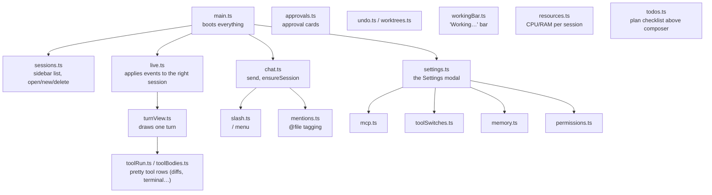

**`live.ts` is the mail sorter.** Every event has a `sessionId`. If it's for the session on screen, it's drawn right away.
If not, it's remembered, and only the sidebar row changes (spinner, unread dot).

**The sidebar is a drawer.** In the Agent view it floats over the chat, like a sheet of paper laid on top, so the chat never squeezes or shifts. A click outside, Escape, or picking a session puts it away; clicking the Agent button on the left brings it back (there's no separate sidebar button). The Chat view (ChatGPT, Claude…) has no sidebar at all: those pages are real mini-browsers stuck on top of the window, and nothing can be drawn over them, so you switch between them with tabs along the top, like a browser.

---

## 14. The whole thing in one picture

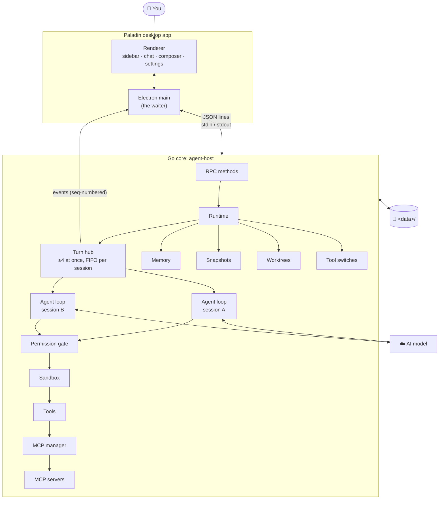

### The 5 rules that make it robust

1. **Answer fast, work in the background.** Requests return right away, and progress arrives as events.
2. **Every session is its own lane.** One stuck or failing session never blocks the others.
3. **Never lose work.** Save on every turn, write atomically, save on quit, pair every tool call with a result.
4. **Expect failure.** Retries with backoff, watchdogs, panic catchers, MCP restarts, doom-loop guard.
5. **Ask before danger.** Permission presets, approval cards, sandbox, folder trust, and asking before the tool list changes.
