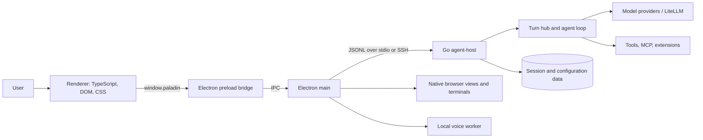

# Paladin

Paladin is a desktop coding agent. The Electron application provides chat, an IDE, terminals, browser surfaces and settings; a Go process called `agent-host` owns sessions, model requests, tools and persistence. The two halves communicate through a JSON-lines protocol. The desktop can start the core locally or run the same core over SSH.

This README maps the system as a whole. The [core README](core/README.md) explains the Go runtime; the [desktop README](desktop-app/README.md) covers Electron and the renderer. [PROTOCOL.md](desktop-app/PROTOCOL.md) is the authoritative request, response and event reference. The [extension](core/internal/extension/README.md) and [plugin UI](docs/PLUGIN-UI.md) documents describe those interfaces in detail.

## System boundaries

The renderer does not own the agent loop or provider credentials. It calls the API wrapper in `desktop-app/src/core/api.ts`; preload exposes a narrow IPC bridge, and Electron main forwards core requests to the sidecar. In core mode, each input line is a JSON request and each output line is a response or event. Stdout is reserved for this protocol; diagnostics go to stderr. Provider HTTP streaming and MCP transports are separate from the desktop-to-core connection.

Electron owns native window and browser surfaces, whereas the Go core owns agent decisions and workspace operations. A remote core runs tools, sessions, provider access and storage on the remote host. Browser views and microphone capture remain on the desktop. See the [desktop connection description](desktop-app/README.md#local-and-remote-core) for the SSH boundary.

## What happens to a message

1. The composer resolves file tags, copies attached images into the session when applicable, selects the provider, model and permissions, and calls `submitChat`.
2. The host dispatcher validates and schedules the request. The turn hub returns a turn ID and a running or queued state without waiting for the answer. It serializes turns within a session and can run different sessions concurrently.
3. The runtime builds an agent from the selected provider, transcript, prompt, project instructions, memory snapshot, available tools and permission policy.
4. The agent sends model rounds, emits text and reasoning, executes requested tools through the permission gate, appends results, and continues until it finishes, is stopped or encounters an unrecoverable error. A turn has no fixed productive-round limit.
5. The hub emits sequenced events. The renderer routes them to the appropriate session, updates the chat and related panels, and can reattach to a running turn after a session switch.
6. The core checkpoints work and records the transcript, usage and other session data. A finished turn is not dependent on the chat remaining visible.

See [turn execution](core/README.md#turn-execution) and [renderer state](desktop-app/README.md#renderer-state-and-events) for the recovery and replay details.

## Main components

| Location | Responsibility |
| --- | --- |
| `core/cmd/agent-host/` | JSONL entry point, dispatcher, RPC registration and event output. |
| `core/internal/runtime/` | Runtime composition, turn hub, sessions, approvals, subagents, MCP, jobs, undo and worktrees. |
| `core/internal/agent/` | Per-turn model/tool loop, prompt construction, retries, compaction and stopping rules. |
| `core/internal/inference/` | Provider interfaces, catalogs, dialect routing, streaming and usage. |
| `core/internal/tools/` | Built-in tool registry and implementations. |
| `core/internal/transcript/`, `session/`, `memory/` | Session files, history views, usage and memory. |
| `desktop-app/electron/` | Electron main and preload, sidecar/SSH transport, browser views, plugin host and voice process. |
| `desktop-app/src/core/` | Renderer API boundary, shared state, DOM references and types. |
| `desktop-app/src/features/` | Chat, sessions, model picker, IDE, browser, settings and other UI features. |
| `desktop-app/src/styles/` | Feature CSS and shared theme tokens, imported in order by `src/styles.css`. |
| `desktop-app/e2e/` | Playwright renderer, Electron and opt-in live integration tests. |

## Providers, tools and state

Provider definitions and model catalogs belong to the core. The renderer asks for a provider and model; the core resolves their configuration and protocol. LiteLLM is an OpenAI-compatible provider configured with a URL and key; Paladin does not run the proxy. GitHub Copilot uses its own authentication and catalog, including endpoint information used for model routing. Provider limits, token usage, pricing and context choices feed the model picker, compaction and usage views. Catalog refresh is scoped to the selected/default provider, not a refresh of every provider. Details and limitations are in the [core README](core/README.md#providers-and-models).

The agent can use built-in tools, MCP servers and enabled extension plugins. Calls go through the registry and permission system before execution; plan mode restricts available tools. The interactive user terminal is a separate PTY and runs directly with user account permissions, as do approved agent commands. Browser tabs for the user, the agent-controlled browser, and plugin iframes are distinct surfaces with different storage and permissions.

Sessions contain a workspace, transcript, settings and usage. The core's data directory defaults to the OS configuration directory plus `paladin`; `PALADIN_DATA_DIR` overrides it. Provider secrets normally use the OS keychain; tests can use `PALADIN_KEYSTORE=memory`. Session history and configuration live under the data directory, not in the source checkout. See [storage and recovery](core/README.md#storage-and-recovery).

## Build and validation connections

The root `Makefile` connects voice asset preparation, the Go sidecar, the renderer and Electron packaging:

| Command | Effect |
| --- | --- |
| `make` or `make app-dev` | Prepare voice assets, build the sidecar and Electron code, then run Vite and Electron for development. |
| `make app` | Prepare voice assets, clean generated outputs, build the release sidecar and package the desktop app into `desktop-app/release/`. |
| `make test` | Run Go tests, UI typechecking, build checks and Playwright tests. |
| `make lint` | Run the configured Go and desktop lint/dead-code checks. |
| `make fmt` | Apply the configured Go and desktop formatters. |
| `make voice` / `make voice-all` | Prepare the default voice assets / all registered models. |

`make app` invokes `make clean`, which removes generated build output and test results. The default voice runtime archive and Tiny model are vendored; optional models or missing assets may require a download. Use the project's existing internal package registry configuration for dependency installation. These commands do not start a LiteLLM proxy.
