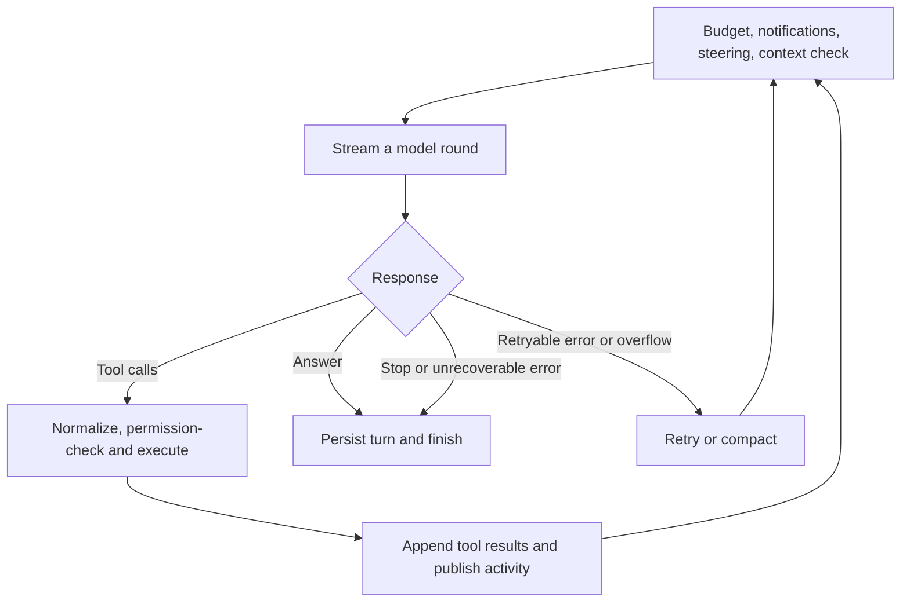

# Paladin Go core

The Go core is the agent runtime behind Paladin. Its executable, `cmd/agent-host`, exposes session, configuration, tool and turn operations over JSON lines on stdin/stdout. Electron normally starts it as a sidecar; an SSH connection starts the same executable remotely. It does not expose the desktop protocol as an HTTP server.

Read the [root architecture](../README.md) for the process boundaries and [desktop protocol](../desktop-app/PROTOCOL.md) for the complete wire contract. The protocol document and `cmd/agent-host/methods.go` are co-owned: adding or removing an RPC requires updating both.

## Entry point and dispatch

`cmd/agent-host/main.go` constructs the runtime, connects event sinks and reads one JSON request per line. A request includes `id`, `method` and `params`; the response carries the same ID and either a result or an error. Unsolicited events carry an event name and, for turns, session/turn identifiers and a sequence number. Stdout is exclusively JSONL; startup and diagnostic messages go to stderr.

`dispatcher.go` classifies calls by execution behavior. Status and control operations can answer inline, reads use bounded workers, and session mutations are ordered by session. Long operations use a separate class. The runtime's turn hub handles model turns independently of the RPC response, allowing the UI to remain responsive and cancellation or approval replies to reach a running turn.

```text
JSONL request → dispatcher → methods.go → AgentRuntime → result
                                      └→ turn hub → background turn → events
```


## Runtime and turn scheduling

`internal/runtime/` connects providers, sessions, tools, permissions, MCP, LSP, memory, snapshots and the hub. `SubmitTurn` resolves session attachments, validates the request and hands it to the hub. The hub permits one active turn per session, queues further turns for that session, and allows turns in different sessions to run concurrently. The default concurrency is four, configurable up to 16. Steers go to a running turn; queued turns and running turns can be cancelled separately.

The hub publishes globally sequenced lifecycle and `chat/*` events. `attach` returns a consistent snapshot of the newest history page, live turn, queued turns, buffered events and sequence position. A client can render the snapshot and ignore events already represented in it. Older history is obtained with `sessionHistoryPage`. Background turns continue when a different session is selected. On shutdown the runtime stops turns and closes its managed services; Electron handles sidecar restart and reconnection.

## Turn execution

`internal/agent/template.go` resolves the turn's session, provider, prompt, tool registry, permission gate and runtime dependencies. `agent.go` manages the turn state and journal; `loop.go` runs model rounds:



A productive turn has no fixed round cap. Guards handle repeated calls, repeated denials, stalled planning, empty responses, provider retries and unproductive compaction. Compatible independent tool calls can run concurrently; conflicting calls remain ordered. Streaming events include text, reasoning, tool activity, retries, approval requests, compaction and usage. Partial work is checkpointed so an interrupted turn can be represented rather than silently rerun.

### Context and usage

`compact.go` estimates the next prompt from reported usage and subsequent messages. Automatic compaction uses the session's selected input window and threshold, 90% by default. The session choice is checked again during a running turn. A provider-reported context overflow can also trigger reactive compaction; `/compact` requests it explicitly. Older messages are summarized while a valid recent tail is kept, and the transcript retains a compaction marker and replay records. New markers retain the before/after estimates; older records may lack the latter. Compaction has a limit on repeated attempts that fail to free useful space.

Usage is tracked per call and persisted per session. Provider-reported charges, catalog pricing and estimated values are distinct; unavailable pricing is not proof that a call was free. A session budget relies on tracked cost and therefore is not a guaranteed cap. `runtime/compact_settings.go`, `runtime/usage.go` and `session/` connect these values to the UI.

## Providers and models

`internal/config/` stores provider definitions, model metadata and settings; credentials normally use the OS keychain. `internal/inference/` exposes a provider interface to the agent and implements the request formats, streaming, retry classification and usage handling behind it.

- An OpenAI-compatible provider such as LiteLLM is configured with a base URL, key and model. The local LiteLLM proxy is external to Paladin.
- OpenCode Go and GitHub Copilot use provider-specific routing. Copilot's catalog can advertise supported endpoints and model limits; routing chooses an available chat-completions, Responses or Messages dialect from the metadata, with fallback behavior where metadata is absent.
- Copilot requests follow the VS Code Copilot extension. The API is chosen as Responses, then Messages, then chat completions. Every call carries a request id, an interaction id (one per user prompt), an interaction type and `X-Initiator` (`user` only for the first round of a fresh prompt). Claude runs on `/v1/messages` with adaptive or budgeted thinking, signed thinking blocks replayed before their tool calls, and at most four prompt-cache markers; chat completions carry `copilot_cache_control` breakpoints, VS Code's sampling defaults and normalised tool schemas; Responses asks for encrypted reasoning with `store:false`. Reasoning is replayed only to the model that produced it, and a different model's reasoning is dropped. Chat completions replay it only within the current prompt; Responses and adaptive Messages models also replay earlier prompts.
- The inference package contains Responses, Anthropic Messages and Google wire implementations used by provider routing. The standalone `anthropic` and `google` provider templates currently return an unimplemented error; their existence as wire dialects does not make those standalone templates usable.
- Catalog metadata can supply context/input limits, output limits, reasoning levels and pricing. Refresh affects the requested provider; the desktop may refresh its default provider. The model picker and per-session context choice use the resulting metadata.

Provider-facing network calls are distinct from the JSONL protocol. Tests using a real provider must be explicitly configured; ordinary unit tests use local doubles.

### Model selection and prompt inputs

The desktop submits provider and model IDs, while the runtime resolves missing selections against the session and provider defaults. `runtime/runtime.go` assembles the turn request and `agent/template.go` combines it with the prompt, tool definitions and session history. The context window shown by the desktop can represent a total window while the compaction threshold uses the provider's input limit; a provider may advertise more than one input option. A session can retain its own model-specific window and percentage without changing the application default.

Prompt material comes from the configured system prompt, built-in guidance, workspace instructions, available skills and the session's memory snapshot. A command or selected skill can alter the turn's inputs and mode. Thinking/reasoning output is presented and persisted separately from the assistant's answer; provider support and settings determine what is requested. The reasoning, with any encrypted state the provider returns, is stored with each assistant message and sent back on later rounds to the same provider and model; after a model switch only its readable text goes back. Side chats are stored separately from the main conversation, although their usage can contribute to the session accounting.

## Tools and policy

`internal/tools/` registers built-in file, search, shell, planning, browser, web, memory and other tools. The runtime combines them with enabled MCP tools, filters the set for the session and mode, and gives schemas to the provider. A tool request is normalized, checked by the guard and routed to its implementation. The permission broker publishes approval events and waits for a response without blocking other sessions.

Agents always run with full access; `internal/permission/` holds the guard (`guard.go`, `shellparse.go`) and the gate that wires it into the tool loop. The guard asks the user once before wipe-style deletes, exposing ports and credential theft or persistence; everything else runs with ordinary user privileges and no OS sandbox. There are no modes or saved rules. External agents run wide open under their own enforcement.

The agent shell tool manages jobs. Output is written to session job logs, and a long foreground operation can return a job ID for later wait, status or cancellation. A user-opened terminal is instead an interactive PTY managed through the desktop/host terminal path and runs with the user's OS permissions.

A turn's tool definitions and policies connect several layers:

1. Tool settings and session acceptance determine which registered tools are visible to the model; plan mode can further restrict them.
2. The agent decodes and normalizes arguments and groups compatible calls. The registry resolves the name to a built-in or MCP tool.
3. The gate evaluates the action and applicable rules; a pending approval is sent as an event and resolved by a later RPC. An approval pauses that request, not every session.
4. The approved tool runs with the user account permissions or its external agent execution policy. Its output becomes a model-facing tool result and a renderer-facing activity event. Long output can be retained on disk with a shortened inline result.

`internal/mcp/` owns server discovery and lifecycle, and provides tools through the normal registry and permission gate. Hooks run at defined lifecycle points. LSP services provide diagnostics to editing flows. Skills, commands, custom prompt text and workspace instructions add context or change turn behavior. Subagents have their own sessions and turns, controlled through the parent. Undo snapshots and worktrees are implemented by `internal/snapshot/` and `internal/worktree/` with runtime coordination.

## Storage and recovery

The data root is `PALADIN_DATA_DIR` when set, otherwise the OS configuration directory joined with `paladin`. Important locations include:

```text
<data>/
  config/                 provider metadata, settings, prompts and MCP config
  sessions/<workspace>/<session>/
    meta.json             session identity and settings
    messages.jsonl        persisted conversation and compaction records
    usage.json            usage ledger
    active-turn.json      in-progress recovery journal when present
    attachments/          copied user attachments
    tool-output/          retained long outputs
    tmp/                  shell job logs
    browser/screenshots/  agent browser captures
    side-chats/           side conversations
  memory/                 user, global and per-project memory
  snapshots/              undo snapshot repositories
  logs/                   host-level logs
```

`internal/transcript/` owns the session store, message records, metadata and turn journal; `internal/session/` builds the client-facing history and usage views. Configuration and durable structured writes use the project's atomic-file facilities. A journal can recover a turn interrupted by a crash; a tool whose result was not saved is not automatically repeated. Memory has global and workspace scopes and a session snapshot; `sessionindex/` supports searching prior sessions. Session and host error logs can contain raw diagnostic details, so treat them as sensitive.

### Maintenance and shared state

The core maintains several related but separate stores. Provider metadata and settings are global configuration; model and context choices can also be saved on a session. Memory has user, global and workspace scopes, while a turn sees the session's frozen memory snapshot until it is refreshed. The search index is derived from transcripts rather than replacing them. A subagent is a separate session associated with its parent; a worktree is a separate workspace checkout, not a session transcript.

Undo uses snapshots managed under the data directory. Every user turn takes a start snapshot, and a completed mutating turn takes an end snapshot, so each turn's edits are computed from its own start/end pair; every turn is revertible, however many there are. Snapshot availability and coverage are reported to the UI, and reverting is coordinated with session state. Workspace files and the session's own transcript are different kinds of state: deleting or reverting one should not be described as automatically deleting every other store.

Completed turns also record an end snapshot for change summaries. Read-only turns do not claim workspace edits, and later changes do not alter completed summaries. Attribution in a shared workspace is best effort: simultaneous edits during a mutating turn can still appear in that turn, and older snapshots may lack an end boundary. History reads keep a bounded in-memory cache that is invalidated when the transcript file changes.

## Working on the core

From the repository root, `make test` runs the complete project checks and `make lint` runs the configured linters. For a focused Go change, run the affected package's tests from `core/`, for example `go test ./internal/agent ./internal/runtime`. `go build -o bin/agent-host ./cmd/agent-host` builds the local host. The root `make app` is the cross-platform release path and supplies the release build flags and executable naming.

Use a temporary `PALADIN_DATA_DIR` and `PALADIN_KEYSTORE=memory` for isolated integration tests. `PALADIN_SNAPSHOTS=off` disables undo snapshots when a test does not need them. External provider tests require explicit configuration and can incur provider usage.
