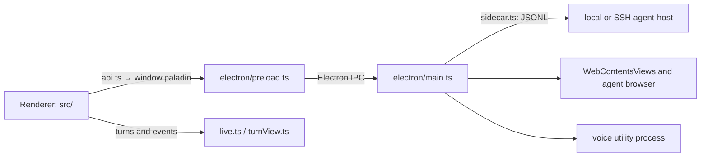

# Paladin desktop

The desktop application is an Electron shell and a vanilla TypeScript renderer. Electron owns the operating-system window, the core connection and native surfaces; the renderer owns the interactive UI. The Go core owns sessions, agent execution, provider requests and tools. The [root README](../README.md) shows the full system, the [core README](../core/README.md) describes the agent runtime, and [PROTOCOL.md](PROTOCOL.md) defines the JSONL and IPC interfaces.

## Process and source layout

| Path | Responsibility |
| --- | --- |
| `index.html` | Single-window markup, CSP and startup shell. |
| `src/main.ts` | Initializes features, loads workspace and sessions, and connects to the core. |
| `src/core/api.ts` | Renderer wrapper for core RPCs and desktop bridge operations. |
| `src/core/state.ts`, `dom.ts`, `types.ts` | Shared state, element references and contract types. |
| `src/features/` | Chat, sessions, model selection, IDE, settings, voice and side-pane behavior. |
| `src/styles.css`, `src/styles/` | Tailwind entry, theme tokens and feature stylesheets. Import order affects the cascade. |
| `electron/main.ts`, `preload.ts` | Window, trusted IPC, lifecycle and the context-isolated renderer bridge. |
| `electron/sidecar.ts`, `remote.ts` | Local or SSH host startup, JSONL requests, event delivery and reconnection. |
| `electron/browser*.ts`, `voice.ts` | Native browser and on-device voice boundaries. |
| `e2e/` | Playwright tests, renderer stub and opt-in live tests. |

There is no React framework or client-side router. Features manipulate DOM and shared state directly. The application uses one main window; the agent conversation and side surfaces are views within it.

## Renderer state and events

`src/main.ts` initializes the feature modules and connects to the core. Feature code uses `src/core/api.ts` rather than invoking the preload bridge directly. `chat.ts` handles composer input, slash routes, file tags and attachment submission. The model picker tracks provider and model, exposes catalog metadata and saves session-specific context/compaction choices. The core, not the composer, decides when to compact.

`live.ts` routes turn events by session and keeps a detached DOM root per session. `turnView.ts` paints streaming text, reasoning, tool activity, approvals and compaction notices. Sequence numbers prevent a reattachment snapshot and live events from painting the same update twice. Delta updates are coalesced, and detached sessions can repaint on attachment. The sidebar uses turn lifecycle events for running, queued and approval indicators.

When a session opens, `attach` supplies a page of persisted history plus the live turn, queue, buffered events and sequence. `sessionHistoryPage` loads older history. Finished turns fetch the small amount of additional session data they need rather than repeatedly loading the entire transcript. Copied image attachments are shown in the user turn and restored from session history; tagged workspace paths remain available to the agent.

The Sessions, Files and Tabs controls share the left rail across agent and IDE modes. The IDE feature is loaded on demand and provides workspace navigation, file editing, diagnostics, changes and a terminal dock. Opening a rail drawer does not itself require a mode change. Settings, model selection, context controls and other overlays live in the renderer.

### Feature boundaries

| Renderer area | Main modules and connections |
| --- | --- |
| Conversation | `chat.ts` submits messages; `live.ts`, `turnView.ts`, `toolRun.ts` and `chatView.ts` render events and history. |
| Sessions and context | `sessions.ts` and `sessions/history.ts` attach and page history; `contextBox.ts`, `models.ts`, `thinking.ts` and `usage.ts` render current controls and accounting. |
| IDE and changes | `ide.ts` and `features/ide/` own editor, explorer and diagnostics; side-pane change modules display session diffs. |
| Side surfaces | `sidePane.ts` coordinates session tabs; `sidePane/` implements browser, web, terminal, side-chat, agent and changes tabs. |
| Configuration | `settings.ts` and feature-specific modules call the core for providers, memory, tools, MCP and related settings. |
| Input | `mentions.ts`, `tags.ts` and `attachments.ts` prepare file references and copied uploads before `chat.ts` submits a turn. |

The preload bridge exposes named desktop capabilities as well as the generic host RPC entry point. Electron validates privileged IPC against the main frame. Renderer state is presentation state: a sidecar restart or session reattachment must obtain authoritative turn and history state from the core.

## Local and remote core

For a local connection, Electron launches the built `agent-host` binary with piped stdio. `sidecar.ts` associates JSONL responses with pending calls and forwards events to the renderer. It monitors the process, applies request deadlines and attempts to restart a failed host with backoff. The core reserves stdout for JSONL and sends diagnostic output to stderr.

For an SSH connection, `remote.ts` starts the configured absolute host binary with `ssh -T`, batch authentication and strict host-key checking. The same JSONL protocol flows through SSH; Paladin does not create a separate core HTTP server. The remote host uses its own workspace, data directory, keys, toolchain and processes. A desktop connection is not a shared multi-client server. Browser and voice capabilities remain on the desktop; a remote development server needs a separate port forward before opening it locally.

## Browser surfaces and overlays

Paladin has two browser paths:

- **Web tabs** are user-facing `https` sites in the side pane. They use Electron `WebContentsView`s and share the persistent `persist:paladin-sites` partition. Tabs are associated with a session; open tabs are not restored after restart, while saved sites and the persistent login partition remain. Navigation events update the toolbar and tab title.
- **The agent browser** is controlled through the `browser` tool and the browser side-pane tab. It uses isolated, in-memory session partitions and a local Chromium debugging connection for the bundled Playwright client. Its navigation and egress controls, site permissions, element picker and screenshot flow are implemented in `electron/browser*.ts` and the core browser tool. Localhost and approved web navigation follow those controls; it does not share the web tabs' login partition.

Native views render above HTML, so ordinary CSS z-index cannot put a renderer menu or drawer over them. When an overlay intersects an active native surface, `sidePane.ts` captures a still image and hides the live view; after the overlap ends it restores the live view. This keeps menus, modals and drawers visible without discarding the underlying page. The browser egress guard and trusted-main-frame IPC checks are separate from this visual behavior.

Conversation links route to the appropriate browser surface according to their URL. Browser screenshots are stored under the session and can be sent to a vision-capable model. `build:electron` copies the lockfile-resolved `playwright-core` client into `dist-electron/vendor/`; Electron supplies Chromium, so a separate browser download is not needed for the agent browser.

## Terminals

Interactive terminal tabs use a Go-hosted PTY in the chosen workspace. The renderer uses xterm and loads the terminal implementation when needed. These shells run with the user's OS permissions and are distinct from the agent's permission-gated shell tool.

## On-device voice

The renderer captures microphone audio and sends mono float32 chunks through preload/IPC. `electron/voice.ts` manages a utility process running `voice-worker/worker.mjs`, which loads the Moonshine WebAssembly runtime and the selected local speech model. Recognition events return through IPC and update the composer. The worker is kept warm briefly after use and then exits; audio transcription does not require a model-provider request.

`make voice` prepares the vendored runtime archive and default Tiny model into the app's voice asset layout. `make voice-all` also prepares the other registered models and can require network access. The extracted runtime, copied worker and generated notices are build output. Models can also be discovered in the user data directory. See the [voice worker README](voice-worker/README.md) for the worker protocol and asset details.

## Packaging and isolation

The Vite build emits the renderer with relative asset paths so it can load from the packaged `file:` URL. TypeScript compiles the Electron main and preload files into `dist-electron/`; the packaging helper adds the Playwright client used for browser automation. `electron-builder.json` packages those outputs with the sidecar binary and prepared voice resources. The core protocol remains the same in a packaged build.

The main renderer uses a content security policy and a context-isolated preload. Remote websites do not gain the host's renderer privileges. Browser site isolation and tool-level permission checks address different boundaries. Native tools run without an OS sandbox; a guard asks before catastrophic actions.

## Build and test flow

From the repository root, `make app-dev` prepares voice assets, builds the core and Electron code, and starts Vite on the fixed port 5173 plus Electron. `make app` prepares voice assets, cleans generated build outputs, compiles the release sidecar, builds the renderer and Electron main/preload, then invokes electron-builder. Packages and unpacked output go to `desktop-app/release/`. The build script also repairs recoverable stale pnpm hoisted links in a relocated dependency tree.

Within `desktop-app/`, `pnpm typecheck` checks renderer, Electron and E2E TypeScript; `pnpm lint` runs ESLint, knip and Prettier; `pnpm test:build` checks packaging helpers; and `pnpm exec playwright test` runs the suite. The root `make test` and `make lint` also cover the Go core. Renderer tests generally use `e2e/paladin-stub.js`; Electron tests exercise native integration. Live LiteLLM tests are opt-in and require the local proxy, key and a real built sidecar; ordinary UI tests do not prove provider behavior.

Generated `node_modules/`, `dist/`, `dist-electron/`, `release/` and Playwright reports are not source. Dependency installation must use the existing approved internal registry configuration.
